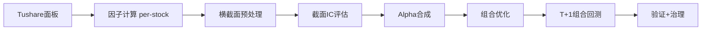

# code_v4：基于 CQF 知识体系的 A 股沪深300 横截面多因子策略方案

> 状态：方案设计（待评审）｜日期：2026-06-01
> 上游知识库：`../cqf-master`（CQF 6 大模块）｜参考实现：`../code_v3`（单标的时序框架，BTC/USDT）

---

## 0. 决策摘要（已锁定）

| 维度 | 决策 | 影响 |
|---|---|---|
| 策略形态 | **横截面多因子选股** | 新建横截面引擎，不平移 code_v3 时序回测器 |
| 标的池 | **沪深300（仅）** | 流动性好、成本可控、容量大、风格相对稳定 |
| 调仓频率 | **日频算因子 / 周频调仓** | 换手适中、成本可控、对 T+1 不敏感 |
| 数据源 | **Tushare Pro** | token 存于 `.env`（已配置） |
| CQF 落地 | **线性多因子(IC加权) + 组合优化器 + ML截面模型 + 行业市值中性化与风控** | 四块全落地 |
| 回测起点 | **2016-01（严格真实成分）** | 受 `index_weight` 最早可用年份约束，无幸存者偏差 |

---

## 1. 一句话定性

构建一个**沪深300 横截面多因子纯多头选股策略**：每日计算因子面板、每周调仓，以 **CQF Module 2（组合管理与最优化）** 的均值-方差组合优化为 alpha-to-weight 核心引擎，复用 code_v3 已沉淀的因子公式、预处理、ML 防泄漏与生命周期治理资产。

---

## 2. 核心架构判断：为什么不是平移 code_v3

`code_v3/migrate_to_v4.py` 原计划把 12 个核心模块整体复制过来。但 **code_v3 本质是单标的时序框架**（BTC 单序列）：

- 它的 IC 是**时序 IC**（同一条序列 `factor_t` vs `future_return_{t+lag}`），不是 A 股的**截面 IC**（同一天跨股票 `factor` vs `forward_return` 的秩相关）。
- 它的"仓位"是单一标量（0~1 杠杆），不是跨股票的**权重向量**。
- 它的回测器 `backtest_v7.py`（6354 行）是单标的事件引擎。

因此 code_v4 是**有选择地复用资产 + 新建横截面层**：

| code_v3 资产 | 在 v4 的命运 | 理由 |
|---|---|---|
| `utils.py`（ema/rsi/macd/atr/zscore/winsorize/standardize/**neutralize**） | **直接复用**，逐股调用 | 技术指标与预处理与资产无关 |
| `factor_builder.py` 因子**公式** | **复用公式**，改为「逐股计算 → 每日横截面标准化」 | 动量/反转/MACD/RSI/波动率公式通用 |
| `factor_evaluator.py` | **扩展**：新增**截面 IC**（现有时序 IC 不能直接用） | 截面是 A 股 alpha 的核心 |
| `ml_strategy.py`（train-only 预处理 + walk-forward 防泄漏） | **概念复用**，预测目标改为截面收益排序 | 防泄漏方法论是资产无关的 |
| `lifecycle_governance/`（因子/信号状态机、append-only 注册、裁决） | **直接复用** | 治理框架资产无关 |
| `backtest_v7.py` | **基本不复用**；仅移植**成本模型**与 `compute_risk_metrics`（Sharpe/Sortino/Calmar/MaxDD/VaR） | 单标的事件引擎不适配组合 |

**最大增量**：映射表 `cqf-master/code_v3_cqf_concept_mapping.xlsx`（58 条）显示 **Module 2（组合管理/优化）当前大多是 `inferred_extension`（推断扩展，未真正落地）**。而组合构建恰恰是横截面选股的灵魂——这是 CQF 知识能给 A 股策略带来真实增量、且 code_v3 完全缺失的环节。

---

## 3. Tushare 数据可用性探测结论（实测）

token 实测有效。各接口最早可用年份：

| 接口 | 用途 | 最早可用 |
|---|---|---|
| `daily` + `adj_factor` | 后复权行情 → 量价因子、收益 | 1991 |
| `daily_basic` | PE/PB/总市值/换手 → 估值/市值/换手因子 | 1999 |
| `suspend_d` | 停牌标记 | ~2005 |
| `index_daily` 000300.SH | 沪深300 指数行情（基准） | 2005-01-04 |
| `stk_limit` | 涨跌停价 → 不可买/不可卖判定 | 2007 |
| **`index_weight` 000300.SH** | **沪深300 point-in-time 成分（月度快照）** | **2016-01-29** ⛔ |

**硬约束**：沪深300 真实历史成分（`index_weight`）最早只到 **2016-01**。这是 universe 的命脉，决定了严格无幸存者偏差回测的起点。2016-01 至今约 10.4 年，已覆盖：2016 熔断后修复、2017 白马、2018 熊市、2019–2020 牛、2021 抱团瓦解、2022 熊、2023–2024 红利/震荡、2025——牛熊与风格切换齐全，足够做 OOS 与稳健性验证。

> 注：`index_weight` 为**月度**快照。日频 universe 通过「月度成分向前填充至下次调整」构建，调仓日按当时生效的月度成分确定可选池。

---
## 4. CQF 知识点 → 组件落点

每个能力锚定到具体 CQF 模块和具体代码组件：



| 层 | CQF 模块 | 落地内容 | 复用/新建 |
|---|---|---|---|
| 收益率/标准化 | M1.1 | log-return、z-score 作为横截面标准化基础 | `utils.zscore` 复用 |
| 均值回归理论 | M1.4 (OU) | A 股短期反转因子的理论支撑（半衰期、回复速度） | 新建说明 |
| 波动率估计 | M3.6 | EWMA/GARCH 波动率 → 协方差估计 + 波动率目标 + 波动调整动量 | `build_vol_adj_momentum` 复用思路 |
| 横截面预处理 | M4.3 | MAD 去极值、行业+市值中性化、train-only 标准化（防泄漏） | `utils.winsorize/standardize/neutralize` 复用 |
| 截面 IC 评估 | M4.4 / 4.7 | 截面 rank IC、ICIR、IC 正向率、分层收益、衰减 | `factor_evaluator` 扩展 |
| Walk-forward | M4.5 | 时序切分 + expanding window + Train/Test IC 对比 | `ml_strategy.walk_forward_validate` 复用 |
| ML 截面 alpha | M4.6 | RandomForest/GBDT 预测截面收益排序 | `ml_strategy._build_model` 复用 |
| **预期收益 μ** | M2.2 | 多因子 **IC 加权合成**（约束优化）→ μ 向量 | `combine_signals_weighted` 升级 |
| **协方差 Σ** | M2.1 / 3.6 | 样本协方差 + Ledoit-Wolf 收缩 / Barra 式因子风险模型 | 新建 |
| **组合优化** | M2.1 / 2.2 | 均值方差 QP `max wᵀμ − (λ/2)wᵀΣw`，约束 long-only / 行业中性 / 单票上限 / 换手上限 | 新建（cvxpy/scipy） |
| **组合风控** | M2.3 | VaR/ES、回撤刹车、波动率目标、暴露上限 | 移植 `compute_risk_metrics` |
| 量价因子/成本/执行/治理 | M6 | 动量/反转/MACD/RSI/量、印花税+佣金+冲击成本、T+1/涨跌停过滤、因子生命周期 | `factor_builder` + `lifecycle_governance` 复用 |

---

## 5. A 股特有约束（必须在引擎里硬编码）

这些是 BTC 框架完全没有、漏掉就会让回测失真的点：

1. **T+1**：t 日信号 → **t+1 成交**（开盘价或 VWAP），买入当日不可卖；最小持有 ≥1 日。
2. **涨跌停板**：开盘一字涨停（主板 ±10%／创业板科创板 ±20%／ST ±5%）→ **不可买入**；跌停 → **不可卖出**。逐日 `tradable_mask`，不可交易的目标权重顺延。
3. **停牌**：停牌股不可调仓，权重冻结，缺口在可交易股票上重分配。
4. **交易成本**：佣金双边（万 2.5~万 3，最低 5 元）+ **印花税卖出单边 0.05%** + 过户费 + 滑点/冲击成本。
5. **做空受限** → **纯多头**组合（选 top 分位）。
6. **后复权**：因子与收益一律用后复权价（`adj_factor`），避免除权跳空污染。
7. **幸存者偏差** → **point-in-time 成分股**：用 `index_weight` 月度真实成分（2016 起），调仓日按当时生效成分构建池。
8. **新股/ST 过滤**：上市 < 60（或 120）日剔除；ST/\*ST 剔除或单列（用 `namechange`）。
9. **财务前视偏差**：基本面因子按**公告日 `ann_date`** 对齐，不是报告期，防用未公布数据。

---

## 6. 数据面板（Tushare Pro）

构建 `(date × stock × field)` 面板，本地 parquet 缓存（Tushare 有积分/频率限制，全 A 分批拉 + 增量更新）：

| Tushare 接口 | 用途 |
|---|---|
| `daily` + `adj_factor` | 后复权 OHLCV → 量价因子、收益 |
| `daily_basic` | PE/PB/PS/total_mv/circ_mv/turnover_rate → 估值/市值/换手因子 |
| `stock_basic` | 上市/退市日、名称 → 新股过滤、point-in-time |
| `index_weight` 000300.SH | 沪深300 月度成分 → universe |
| `namechange` | ST 历史标记 |
| `suspend_d` / `stk_limit` | 停牌、涨跌停价 → `tradable_mask` |
| `income` / `fina_indicator` | ROE/增速等基本面因子（按 `ann_date` 对齐） |
| 申万行业分类 | 行业中性化分类 |
| `index_daily` 000300.SH | 基准曲线、超额收益、IR |

---
## 7. 目录结构（code_v4）

```
code_v4/
├── .env / .env.example / .gitignore   # 凭证与忽略（已创建）
├── PROPOSAL.md                        # 本文档
├── requirements.txt
├── data/
│   ├── tushare_client.py      # 封装 + 限流 + 重试 + 本地缓存
│   ├── universe.py            # point-in-time 沪深300成分 / ST / 新股过滤
│   ├── panel_loader.py        # (date×stock×field) 面板 + parquet 缓存
│   └── adjust.py              # 后复权
├── factors/
│   ├── technical.py           # 复用 code_v3 量价因子（逐股）
│   ├── fundamental.py         # 估值/质量/成长（新）
│   ├── cross_section.py       # 横截面 MAD去极值 / 中性化 / z-score
│   └── factor_panel.py        # 因子面板构建器（对应 FactorBuilder）
├── eval/
│   └── cs_evaluator.py        # 截面 IC / 分层 / 衰减（扩展 factor_evaluator）
├── alpha/
│   ├── ic_weighting.py        # IC 加权合成 μ (M2.2)
│   └── ml_alpha.py            # 复用 ml_strategy → 截面预测 (M4.6)
├── portfolio/
│   ├── cov_estimator.py       # Ledoit-Wolf / 因子风险模型 (M2.1/3.6)
│   ├── optimizer.py           # 均值方差 / 风险平价 QP (M2.1/2.2)
│   └── risk.py                # VaR/ES / 回撤刹车 (M2.3)
├── backtest/
│   └── portfolio_backtester.py # T+1 / 涨跌停 / 停牌 / 成本（新建）
├── validation/
│   └── walk_forward.py        # 复用 ml_strategy walk-forward (M4.5)
├── governance/                # 复用 code_v3 lifecycle_governance
├── configs/                   # 因子/优化器/成本参数 YAML
└── run_research.py            # 主流程入口
```

---

## 8. 因子库（A 股版，三层）

- **量价/技术**（复用 code_v3 公式，逐股）：**短期反转**（20 日，A 股最强 alpha 之一）、波动率、特异度波动 IVOL、换手率、量价背离、MACD、RSI、动量。
- **基本面**（新）：估值 EP=1/PE、BP=1/PB；质量 ROE、毛利率；成长 营收/利润增速；杠杆。
- **横截面处理流水线**（每日，每个因子）：逐股时序计算 → **MAD 去极值** → **行业 + 市值中性化**（`utils.neutralize` 回归取残差，M4.3）→ **横截面 z-score**。

---

## 9. 组合构建（CQF 最大增量）

1. **预期收益 μ**：滚动 IC 加权合成多因子打分（M2.2）；或 ML 预测（M4.6）。
2. **协方差 Σ**：Ledoit-Wolf 收缩样本协方差（M2.1），进阶用 Barra 式因子风险模型 `Σ = XFXᵀ + Δ`。
3. **优化器**（三档对照）：
   - 基线：top 分位等权 / 市值加权；
   - 主力：均值方差 QP `max wᵀμ − (λ/2)wᵀΣw`，约束 `Σw=1, 0≤w≤w_max, |行业暴露−基准|≤ε, 换手≤τ`；
   - 对照：风险平价。
4. **风控**（M2.3）：组合波动率目标、个股/行业上限、回撤刹车。

---

## 10. 分阶段实施

| Phase | 内容 | 验收标准 |
|---|---|---|
| **0** 数据管道 | Tushare 封装、沪深300 point-in-time universe、面板、后复权、`tradable_mask` | 面板无前视；停复牌/涨跌停标记正确；可增量更新 |
| **1** 因子+评估 | 因子库 + 横截面预处理 + 截面 IC 评估 | 单因子 mean IC>0.02、ICIR>0.5、IC 正向率>55% |
| **2** 多因子+回测 | IC 加权合成 + 分层 T+1 回测（含成本） | top-bottom 多空价差显著，成本后仍正 |
| **3** 组合优化 | 均值方差 QP + 协方差收缩 + 风控 | 优化组合 IR 优于等权基线，换手可控 |
| **4** ML alpha | 复用 ml_strategy 截面预测 + walk-forward | OOS IC 不显著衰减，无泄漏 |
| **5** 治理+稳健 | 接 lifecycle_governance + 成本/参数/状态敏感性 + paper | 成本翻倍仍正超额，跨牛熊稳健 |

---

## 11. 风险与失效条件

- **过拟合 / 多重检验**：因子多、参数多，记录测试次数并做校正（Deflated Sharpe / Bonferroni）。
- **前视偏差**：财务 `ann_date` 对齐、后复权、point-in-time 成分股三道关。
- **幸存者偏差**：universe 用真实历史成分（2016 起）。
- **成本低估**：A 股印花税 + 冲击成本，小市值因子尤甚；用成本敏感性测试。
- **容量/流动性**：沪深300 容量较大，但仍需估算策略容量上限。
- **状态依赖**：A 股风格切换剧烈（2017 白马 / 2021 小盘 / 2024 红利），分状态验证。
- **T+1 与涨跌停**：回测-实盘 gap 的主要来源，必须在撮合层模拟。
- **index_weight 月度粒度**：成分变更日内的成分漂移无法捕捉，月内用向前填充近似。

---

## 12. 下一步

候选起步项（任选其一推进）：

1. **Phase 0 落地**：先建 `data/tushare_client.py` + `universe.py` + `panel_loader.py`，拉沪深300 一段样本验证管道与 `tradable_mask` 正确性。
2. **补 A 股版 CQF→代码映射表**：对标 `code_v3_cqf_concept_mapping.xlsx`，作为开发对照。
3. **细化 Phase 3 组合优化器设计**：选定 cvxpy/scipy、约束集、协方差估计方案后再编码。

