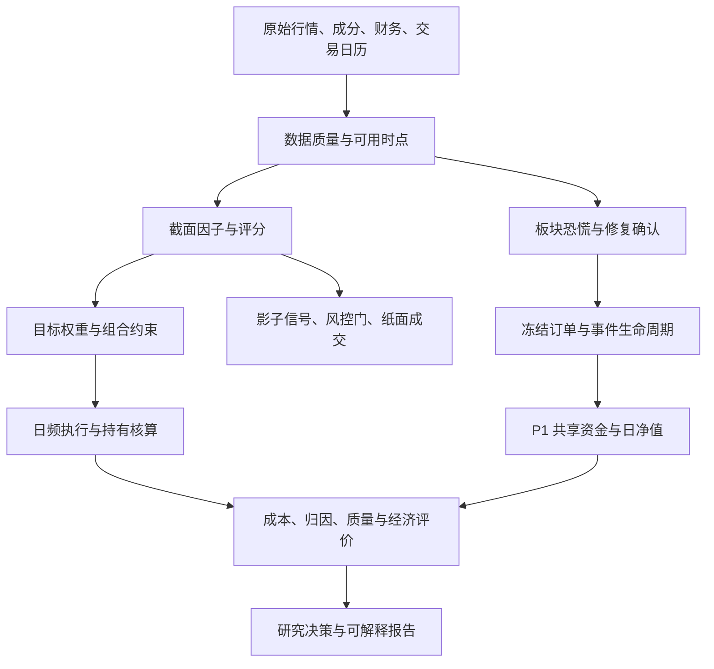

# 根据量化策略研究 JD 重新掌握项目

日期：2026-09-25。目标：能够解释项目中的研究假设、数据时点、公式、代码、账户、验证和结果，并明确哪些能力尚未完成。

本材料基于本地源码定向阅读和冻结产物，不是全库正确性认证。自动代码索引覆盖范围见文件头，索引存在不表示该文件已逐行审计。历史文档与最新运行分开保留。

## 使用顺序

1. 本文件：建立全局认识和学习验收标准。
2. [核心模块精读](01_core_walkthrough.md)：按 JD 贯通数据、策略、模型、回测、执行、监控和业务表达。
3. [实现差异与追问风险](02_implementation_caveats.md)：纠正“注释写了就算做了”的误解。
4. [练习与答案](03_exercises.md)：闭卷推导、手算和追问训练。
5. [源码符号索引](04_source_index.md)：逐文件定位函数；查看 tests 中对应反例。
6. [岗位匹配及最新结果](../jd_application_review_20260925.md)：简历和经济评价口径。

## 先认识四条链路

| 链路 | 核心目的 | 入口与核心目录 | 必须记住的边界 |
|---|---|---|---|
| 截面多因子 | 同一时点给股票排序并构建组合 | run_research.py；data → factors → eval/alpha → portfolio → backtest → validation | 不同策略模式与配置不同；不能将所有模块说成一次运行都使用 |
| 低波/行业/ETF 产品对照 | 比较信号与投资载体、持有核算 | scripts/run_frozen_product_compare.py；products | 最新完整池 r8 仍为机制诊断、DATA_INSUFFICIENT |
| 板块事件与共享账户 | 恐慌事件、修复确认、入场退出、资金竞争 | sector_panic 与 sector_panic/rebuild；对应 scripts | E2 独立事件账户与 P1 共享账户分开；P2 真实资本执行尚未完成 |
| 日终监控与影子执行 | 信号生成、检查、纸面成交、日志 | live；live/photoresist_panic | 影子成交不是真实柜台成交；光刻胶监控不是 P1 三板块账户 |



箭头是学习框架，不代表这些目录之间只有一套统一的生产调用链。

## 每个模块都用同一张掌握卡

每完成一章，独立填写下面九项，不要照抄文档。

| 问题 | 你的答案应达到的程度 |
|---|---|
| 解决什么问题 | 一句话说明研究或账户问题 |
| 输入是什么 | 列出字段、单位、主键、日期 |
| 什么时候可得 | 区分 signal、confirmation、submit、target、fill、valuation |
| 公式是什么 | 可以手算一个最小例子 |
| 调用在哪里 | 找到调用者、函数、实际参数 |
| 输出是什么 | 能解释每个关键字段的含义 |
| 失败怎么办 | 缺价、无数据、不可行、未成交、未到期分别回答 |
| 怎样证明 | 找到一条测试反例和一个实际产物 |
| 不能证明什么 | 区分功能、工程覆盖、统计与经济结论 |

掌握评分：0=没看；1=看懂；2=能脱稿解释；3=能推导与手算；4=能定位代码并解释反例。核心章节达到 4，再用于面试陈述。阅读完成不是掌握完成。

## 建议学习顺序

每单元约 90–120 分钟只是安排参考；不会的单元允许重复。

| 单元 | 对应 JD | 要交出的学习成果 |
|---|---|---|
| 1 全局与版本身份 | 策略全流程 | 画出四条链路，分清 E2/P1/P2 |
| 2 数据与 PIT | 因子库、数据库、市场认知 | 写出三种未来信息误用例子 |
| 3 因子构造与截面处理 | 多因子研究 | 手算反转、跳月动量、z-score |
| 4 IC、标签与动态权重 | 因子评价 | 画出五日标签成熟时间线 |
| 5 ML 与 regime | 统计与机器学习 | 解释实际模型、划分和实现局限 |
| 6 组合优化 | 组合与风险 | 写目标函数，解释不可行和权重漂移 |
| 7 执行、成本、净值 | 独立回测、市场规则 | 手算现金、成本与缺价恢复 |
| 8 恐慌与修复信号 | 策略研究 | 从事件到 d0 的逐日状态表 |
| 9 因果订单与退出 | 交易策略 | 推演“提交后跌破确认价”与受阻退出 |
| 10 P1 共享账户 | 回测到落地 | 手算预留、成交、余款、资金竞争 |
| 11 验证、亏损与归因 | 策略评价与迭代 | 解释 281 笔结果及其不能证明的事 |
| 12 监控、ETF、业务与综合演练 | JD 剩余职责 | 八分钟演示、业务摘要和缺口说明 |

## 一条研究结论的证据链

运行身份 → 绑定输入与配置 → 对应实现 → 订单/成交 → 账本/净值 → 指标 → 质量与评价状态。

不要只读文件夹名中的 v1、r8 或日期来判断权限和完成状态。冻结合同中的旧 NOT_RUN 可以与后续独立运行共存；后续结果不回写旧合同。原始“locked_oos”标签也不能覆盖后来的反复研究使用事实。

## 本次验证记录

执行命令：

```powershell
python -m pytest -q -p no:cacheprovider tests/test_score_to_mu_no_leakage.py tests/test_execution_missing_prices.py tests/test_weekly_long_holding.py tests/sector_panic_rebuild/test_causal_orders.py tests/sector_panic_rebuild/test_cash_reconciliation.py tests/sector_panic_rebuild/test_portfolio_p1_book.py
```

结果：54 passed，5 failed。5 项失败均在导入 scipy.stats/scipy.sparse 时发生，提示当前 SciPy 要求 NumPy >=2.0.0，而检测到 NumPy 1.26.4，随后 AttributeError: numpy has no attribute long。它们没有完成 ScoreToMu 功能断言，不能登记为功能通过，也不能由此判定函数的业务逻辑错误。本次未安装或升级依赖，未修改研究实现。

面试演示前先确认解释器、依赖版本与可用测试环境。不要临场执行全历史研究命令；部分脚本会拉取数据、写入新结果或触及运行冻结机制。
