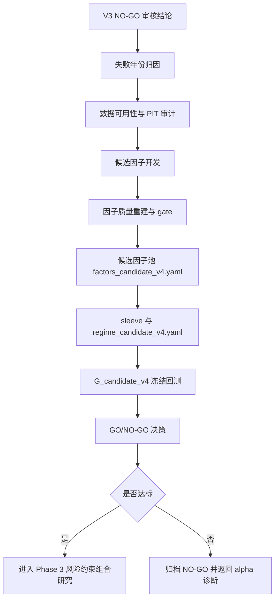

# Strategy V4 Alpha 重建开发方案

生成日期：2026-06-14  
前置文档：

- `docs/strategy_v3_completion_review.md`
- `docs/go_nogo_decision.md`
- `docs/strategy_alpha_failure_report.md`
- `docs/strategy_alpha_failure_diagnosis_development_plan.md`
- `docs/factor_quality_rebuild_development_plan.md`

适用范围：下一阶段策略优化，目标是解决当前策略在全年不同周期、不同趋势环境下泛化不足的问题。

## 1. 背景与当前结论

### 1.1 V3 审核结论

`F_candidate_v3` 已完成工程链路接入和冻结验证，但策略表现仍未达到实盘门槛。

| 指标 | GO 门槛 | V3 实际 | 结论 |
|------|------:|------:|------|
| 平均年化超额 | > 2.0% | -0.3% | 未通过 |
| 中位数年化超额 | > 0.0% | -1.2% | 未通过 |
| 正超额年份 | >= 5/8 | 4/8 | 未通过 |
| 平均 IR | > 0.30 | -0.11 | 未通过 |
| 最大单年超额亏损 | > -10.0% | -15.0% | 未通过 |

V3 相对 V2 有边际改善：

- 2017-2024 中 `6/8` 个验证年改善。
- 平均年度超额改善约 `+0.92pp`。
- 正超额年份从 `3/8` 提升到 `4/8`。

但改善来自 performance overlay 的再分配能力，而不是新增 alpha 供给。当前不能进入实盘，也不建议继续围绕 overlay 做小幅调参。

### 1.2 当前核心瓶颈

现有结果表明，策略失败的主因是底层 alpha 池质量不足。

| 问题 | 证据 | 影响 |
|------|------|------|
| 传统技术因子不稳定 | `factor_quality_rebuild` 中多数技术因子未通过 gate | 趋势市和震荡市切换时信号失效 |
| 价值因子贡献有限 | V2/V3 主要依赖 `bp_cs`、`ep_cs`、`sp_cs` | 可改善部分年份，但无法覆盖成长驱动和质量分化行情 |
| 缺少质量/现金流/盈利稳定性因子 | 现有候选池没有形成有效质量 sleeve | 无法区分便宜资产和价值陷阱 |
| 2017、2023、2024、2026 YTD 仍显著失败 | V3 年度超额分别为 -15.0%、-4.4%、-3.7%、-18.3% | 泛化能力不足，不能实盘 |
| overlay 只能调整权重，不能创造 alpha | V3 改善有限 | 下一阶段必须从 alpha 供给侧重建 |

### 1.3 本阶段定位

V4 不是 V3 的参数微调版，而是一次 alpha 层重建：

```text
V2/V3: 现有 5 因子池 + regime/overlay 调配
V4:    扩展数据与因子池 + 重新筛选 alpha + 重构 sleeve + 冻结候选验证
```

本阶段必须先完成诊断和候选因子建设，再进入冻结回测。不能使用 2026 YTD 或单一年份结果反向调参。

## 2. 总体目标

### 2.1 业务目标

构建一个能在 2017-2024 多市场环境中稳定产生超额的下一代候选策略 `G_candidate_v4`，并通过严格冻结验证判断是否具备实盘候选资格。

### 2.2 工程目标

1. 补齐 alpha 失败年份归因，明确不同年份失败来自因子、sleeve、router、组合构建还是交易成本。
2. 扩展候选因子池，重点新增质量、现金流、盈利稳定性、成长、估值修复、行业相对强弱、风险调整动量等因子。
3. 建立 PIT 安全的数据对齐、公告滞后、因子缓存和 manifest 追踪机制。
4. 使用统一质量 gate 筛选候选因子，形成 `factors_candidate_v4.yaml`。
5. 重构或扩展 sleeve 定义，形成 `regime_candidate_v4.yaml`。
6. 注册 `G_candidate_v4` 并完成 2017-2024 + 2026 YTD 冻结验证。
7. 自动生成 V4 验证报告和 GO/NO-GO 决策文档。

### 2.3 策略 GO 门槛

V4 沿用当前正式策略门槛，不因新版本而降低要求。

| 指标 | 门槛 |
|------|------:|
| 2017-2024 平均年化超额 | > 2.0% |
| 2017-2024 中位数年化超额 | > 0.0% |
| 正超额年份 | >= 5/8 |
| 平均 IR | > 0.30 |
| 最大单年超额亏损 | > -10.0% |

附加建议门槛：

| 指标 | 建议门槛 | 说明 |
|------|------:|------|
| 2023、2024 单年超额 | 不低于 -2.0% | 近年环境不能持续失效 |
| 2026 YTD | 仅观察 | 不作为调参依据，不纳入均值 |
| 平均换手 | 不高于 V3 明显水平 | 避免用高换手换取表面超额 |
| 数据质量 | audit_cache 无 FAIL | WARN 必须解释并落档 |

## 3. 非目标与边界

本阶段明确不做：

1. 不进入实盘或小资金试运行。
2. 不基于 2026 YTD 反向调参。
3. 不用 2025 作为验证集；2025 只能作为 discovery 或压力观察。
4. 不通过大规模参数网格搜索直接寻找最优回测结果。
5. 不在没有 PIT 审计的情况下引入基本面或公告类因子。
6. 不降低 GO/NO-GO 门槛来让候选策略过关。
7. 不把风险因子伪装成 alpha 因子；低波、市值、流动性等必须区分 alpha 与风险控制用途。

## 4. 总体技术路线



核心原则：

- 先诊断，再开发。
- 先 PIT，再 IC。
- 先单因子质量，再组合。
- 先冻结预注册，再完整验证。
- 先判断是否有 alpha，再讨论实盘。

## 5. 数据与因子建设范围

### 5.1 现有可复用输入

| 类型 | 文件或模块 | 用途 |
|------|------|------|
| 因子质量流水线 | `scripts/factor_quality_rebuild.py` | 单因子审计、方向、IC、分位收益、成本、聚类、gate |
| 失败诊断 | `scripts/strategy_alpha_failure_diagnosis.py` | 策略族失败归因 |
| 冻结验证 | `scripts/frozen_backtest_validation.py` | 候选策略跨年复验 |
| 决策文档 | `scripts/generate_go_nogo_decision.py` | GO/NO-GO 自动生成 |
| regime 逻辑 | `alpha/regime_allocator.py`、`alpha/regime_composite.py`、`alpha/regime_detector.py` | 市场状态识别与 sleeve 分配 |
| sleeve 逻辑 | `alpha/strategy_sleeves.py` | sleeve 定义与因子聚合 |
| overlay 逻辑 | `alpha/sleeve_performance_overlay.py` | 作为可选权重调整层 |
| 因子对齐 | `alpha/factor_alignment.py` | PIT 与可用性对齐 |
| 当前候选池 | `configs/factors_candidate_v1.yaml` | V2/V3 基线因子池 |

### 5.2 需要新增或扩展的因子类别

#### 质量类

目标：区分真便宜与价值陷阱，提高 value sleeve 的稳定性。

候选方向：

- ROE 或 ROA 稳定性
- 毛利率稳定性
- 净利率稳定性
- 资产周转率
- 经营质量
- 盈利波动率
- 杜邦分解相关指标

候选因子命名建议：

```text
roe_ttm_cs
roa_ttm_cs
gross_margin_ttm_cs
net_margin_ttm_cs
roe_stability_8q_cs
profitability_quality_cs
asset_turnover_ttm_cs
```

#### 现金流类

目标：用经营现金流验证利润质量，降低财务报表噪声。

候选方向：

- 经营现金流 / 市值
- 经营现金流 / 净利润
- 自由现金流收益率
- 现金流稳定性
- 应收账款压力

候选因子命名建议：

```text
ocf_to_mktcap_cs
ocf_to_profit_cs
fcf_yield_cs
cashflow_stability_8q_cs
accrual_quality_cs
receivable_pressure_cs
```

#### 成长类

目标：覆盖 2017、2019、2020 等成长驱动环境，避免纯 value 暴露。

候选方向：

- 收入同比增长
- 利润同比增长
- 增长稳定性
- 预期改善或历史改善趋势
- 增长质量与估值匹配

候选因子命名建议：

```text
revenue_growth_ttm_cs
profit_growth_ttm_cs
growth_stability_8q_cs
growth_value_match_cs
earnings_acceleration_cs
```

#### 估值修复类

目标：保留 value 有效部分，但避免机械低估值。

候选方向：

- PE/PB/PS 相对行业分位
- 估值历史分位修复
- 盈利改善叠加低估值
- 股息与盈利质量组合

候选因子命名建议：

```text
industry_relative_ep_cs
industry_relative_bp_cs
valuation_reversion_3y_cs
quality_value_composite_cs
dividend_quality_cs
```

#### 行业相对强弱类

目标：降低全市场风格漂移影响，用行业内排序提升可比性。

候选方向：

- 行业内动量
- 行业内盈利改善
- 行业内估值修复
- 行业内质量排名

候选因子命名建议：

```text
industry_relative_momentum_60_cs
industry_relative_quality_cs
industry_relative_growth_cs
industry_relative_value_cs
```

#### 风险调整动量类

目标：修复现有 momentum 类因子在验证期不稳定的问题。

候选方向：

- 跳过最近 5 日的中期动量
- 风险调整动量
- 行业内动量
- 放量确认动量
- 趋势延续但避开极端拥挤

候选因子命名建议：

```text
momentum_60_skip5_cs
momentum_120_skip20_cs
risk_adjusted_momentum_60_cs
volume_confirmed_momentum_cs
trend_quality_cs
```

### 5.3 数据 PIT 要求

所有新增基本面、财务、现金流类因子必须满足：

1. 使用公告日或可获得日对齐，不使用报告期末直接生效。
2. 若无法取得公告日，则必须使用保守滞后规则。
3. 每条因子记录必须能追溯到 `source_date`、`available_date`、`trade_date`。
4. 禁止未来财报穿越到历史交易日。
5. 因子缓存 manifest 必须记录输入数据版本、因子配置哈希和因子列表哈希。

建议新增审计字段：

```text
factor_name
ts_code
trade_date
source_period
source_date
available_date
value
pit_lag_days
is_stale
```

## 6. 里程碑计划

### M0：V3 归档与问题闭环

目标：把 V3 作为已验证 NO-GO 候选归档，补齐缺失文档，避免后续混淆。

任务：

| ID | 任务 | 产物 | 验收 |
|----|------|------|------|
| M0.1 | 补齐 V3 vs V2 独立比较文档 | `docs/candidate_v3_vs_v2_comparison.md` | 包含年度差异、平均改善、失败年份 |
| M0.2 | 补齐 V3 开发日志 | `docs/strategy_v3_development_log.md` | 包含关键命令、产物、最终 NO-GO |
| M0.3 | 修正 GO/NO-GO 汇总表回撤字段名 | `scripts/generate_go_nogo_decision.py` | `Max DD` 改为 `Avg Max DD` 或新增 `Worst Max DD` |
| M0.4 | 增加测试覆盖回撤字段口径 | `tests/test_go_nogo_decision.py` | pytest 通过 |

验收命令：

```powershell
python -X utf8 -m pytest tests\test_go_nogo_decision.py -q
python -X utf8 scripts\generate_go_nogo_decision.py --runs outputs\validation\frozen_backtest\runs.csv outputs\validation\candidate_v2\runs.csv outputs\validation\candidate_v3\runs.csv
```

### M1：失败年份归因深化

目标：定位 2017、2023、2024、2026 YTD 的失败来源，为因子开发排序。

重点年份：

| 年份 | 当前现象 | 诊断重点 |
|------|------|------|
| 2017 | V3 超额 -15.0% | 成长风格缺失、value 陷阱、行业暴露 |
| 2023 | V3 超额 -4.4% | 弱市反弹失败、组合穿透、交易成本 |
| 2024 | V3 超额 -3.7% | 价值/红利/行业轮动捕捉不足 |
| 2026 YTD | V3 超额 -18.3% | 仅观察，不调参；用于压力解释 |

任务：

| ID | 任务 | 产物 | 验收 |
|----|------|------|------|
| M1.1 | 重新运行策略族失败诊断 | `outputs/analysis/strategy_alpha_failure/*` | 产物完整，脚本无异常 |
| M1.2 | 整理失败年份月度超额拆解 | `docs/failure_year_monthly_attribution_v4.md` | 每个失败年明确主要亏损月份 |
| M1.3 | 拆解 factor/sleeve/router/construction/cost 贡献 | `docs/strategy_failure_source_matrix_v4.md` | 每年有主因排序 |
| M1.4 | 给出因子开发优先级 | `docs/alpha_rebuild_priority_list.md` | 明确 P0/P1/P2 因子类别 |

建议命令：

```powershell
python -X utf8 scripts\strategy_alpha_failure_diagnosis.py
```

验收标准：

- 不能只写“alpha 不足”，必须落到具体年份、月份、sleeve 和因子类别。
- 每个失败年份必须有一个主假设和至少一个反证检查。
- 2026 YTD 只能做解释，不能作为参数选择依据。

### M2：数据可用性与 PIT 审计

目标：确认新增因子所需数据是否可用、是否能安全对齐、是否能进入回测。

任务：

| ID | 任务 | 产物 | 验收 |
|----|------|------|------|
| M2.1 | 梳理可用数据字段 | `docs/v4_data_inventory.md` | 字段、频率、起止时间、缺失率 |
| M2.2 | 定义 PIT 对齐规则 | `docs/v4_pit_alignment_rules.md` | 每类数据的 available_date 规则 |
| M2.3 | 实现或扩展数据审计脚本 | `scripts/audit_alpha_inputs_v4.py` | 输出缺失率、重复、可用日、未来数据检查 |
| M2.4 | 为 PIT 审计加测试 | `tests/test_alpha_inputs_v4.py` | 覆盖公告滞后、未来数据拒绝、stale 标记 |

验收命令：

```powershell
python -X utf8 scripts\audit_alpha_inputs_v4.py --start 20170101 --end 20241231 --out outputs/analysis/v4_alpha_inputs
python -X utf8 -m pytest tests\test_alpha_inputs_v4.py -q
```

验收标准：

- 任一新增基本面因子若无法证明 PIT 安全，不得进入候选池。
- 数据字段覆盖不足的因子必须列入 `blocked_factors`，不能静默缺失。
- 审计报告必须区分 `missing`、`stale`、`future_leakage`、`constant`、`duplicate`。

### M3：候选因子开发

目标：实现 V4 候选因子计算与缓存，形成可被质量 gate 读取的统一格式。

新增建议文件：

| 文件 | 说明 |
|------|------|
| `scripts/build_alpha_factors_v4.py` | V4 因子构建入口 |
| `configs/factors_alpha_v4_universe.yaml` | V4 原始候选因子全集 |
| `configs/factor_build_v4.yaml` | 因子构建参数、滞后规则、缓存路径 |
| `tests/test_alpha_factors_v4.py` | 因子计算、方向、PIT、缺失处理测试 |
| `docs/alpha_factor_definitions_v4.md` | 每个因子的经济解释、公式和数据依赖 |

任务：

| ID | 任务 | 说明 |
|----|------|------|
| M3.1 | 实现质量类因子 | ROE/ROA/毛利率/盈利稳定性 |
| M3.2 | 实现现金流类因子 | OCF、FCF、应计质量 |
| M3.3 | 实现成长类因子 | 收入增长、利润增长、增长稳定性 |
| M3.4 | 实现估值修复类因子 | 行业相对估值、历史分位、质量价值组合 |
| M3.5 | 实现行业相对强弱类因子 | 行业内排序，降低行业漂移 |
| M3.6 | 实现风险调整动量类因子 | skip-window、波动调整、成交确认 |
| M3.7 | 写入因子缓存与 manifest | 哈希、因子列表、输入版本 |

建议命令：

```powershell
python -X utf8 scripts\build_alpha_factors_v4.py --config configs\factor_build_v4.yaml --start 20170101 --end 20241231 --force
python -X utf8 scripts\build_alpha_factors_v4.py --config configs\factor_build_v4.yaml --start 20260101 --end 20260605 --force
```

验收标准：

- 每个因子都能在 `data/parquet/factors/factor_name=<factor>` 下生成缓存。
- 每个因子无重复 `(ts_code, trade_date)`。
- 每个因子缺失率、stale 比例、日期覆盖在报告中可见。
- 每个因子都有文档解释和公式。
- PIT 类测试全部通过。

### M4：因子质量重建与候选池筛选

目标：用统一 gate 筛掉无效因子，输出 `factors_candidate_v4.yaml`。

基准窗口：

| 窗口 | 年份 | 用途 |
|------|------|------|
| calibration | 2017-2020 | 方向选择、基础筛查 |
| validation | 2021-2024 | gate 判定 |
| discovery/watch | 2025、2026 YTD | 仅观察，不参与通过判定 |

建议复用并扩展：

- `scripts/factor_quality_rebuild.py`
- `configs/factor_quality_rebuild.yaml`
- `tests/test_factor_quality_rebuild.py`

V4 gate 建议：

| 维度 | 门槛 |
|------|------:|
| Input audit | PASS |
| PIT audit | PASS |
| validation mean rank IC | > 0.01 |
| validation ICIR | >= 0.20 |
| 正 IC 年数 | >= 3/4 |
| 5d net spread after cost | > 0 |
| 正 spread 年数 | >= 3/4 |
| top quintile net excess | > 0 |
| cost resilience | >= 50% |
| 单年贡献集中度 | < 60% |
| 与已入选因子相关性 | 同 cluster 保留最强者 |

任务：

| ID | 任务 | 产物 |
|----|------|------|
| M4.1 | 扩展 quality rebuild 配置到 V4 因子池 | `configs/factor_quality_rebuild_v4.yaml` |
| M4.2 | 跑完整质量重建 | `outputs/analysis/factor_quality_rebuild_v4/*` |
| M4.3 | 生成人工复核列表 | `docs/factor_quality_manual_review_v4.md` |
| M4.4 | 输出候选因子池 | `configs/factors_candidate_v4.yaml` |
| M4.5 | 记录未通过因子和原因 | `docs/factor_rejection_log_v4.md` |

建议命令：

```powershell
python -X utf8 scripts\factor_quality_rebuild.py --config configs\factor_quality_rebuild_v4.yaml --out-dir outputs\analysis\factor_quality_rebuild_v4 --out-doc docs\factor_quality_rebuild_v4_report.md
```

验收标准：

- 不能只看总体 IC，必须有分年度结果。
- 所有进入 `factors_candidate_v4.yaml` 的因子必须通过 gate 或被明确标记为人工保留。
- 人工保留必须写明经济理由、风险和预期使用方式。
- 若 PASS 因子数不足 5 个，应停止策略组装，回到 M3 扩展因子。

### M5：Sleeve 重构与 regime 映射

目标：根据通过 gate 的因子重新构建 sleeve，避免旧 sleeve 结构吞噬 alpha。

建议 sleeve：

| Sleeve | 目标 | 可能因子 |
|------|------|------|
| quality_value | 低估值 + 高质量 | `industry_relative_ep_cs`、`quality_value_composite_cs`、`roe_stability_8q_cs` |
| cashflow_quality | 现金流验证盈利 | `ocf_to_profit_cs`、`fcf_yield_cs`、`accrual_quality_cs` |
| growth_quality | 增长但不过度追高 | `growth_stability_8q_cs`、`earnings_acceleration_cs` |
| risk_adjusted_momentum | 趋势确认 | `risk_adjusted_momentum_60_cs`、`volume_confirmed_momentum_cs` |
| defensive_quality | 弱市防守 | `profitability_quality_cs`、`volatility_60_cs`、`log_market_cap_cs` |

新增或修改文件：

| 文件 | 说明 |
|------|------|
| `configs/regime_candidate_v4.yaml` | V4 sleeve 与 regime 映射 |
| `alpha/strategy_sleeves.py` | 如需新增 sleeve 类型，在此扩展 |
| `tests/test_regime_candidate_v4_config.py` | 校验 V4 regime 配置 |
| `docs/sleeve_design_v4.md` | sleeve 经济解释、因子组成、权重规则 |

任务：

| ID | 任务 | 说明 |
|----|------|------|
| M5.1 | 设计 V4 sleeve | 每个 sleeve 必须有经济解释 |
| M5.2 | 建立因子到 sleeve 的映射 | 保证每个 sleeve 至少 2 个候选因子，避免单因子 sleeve |
| M5.3 | 设计 regime 到 sleeve 权重 | 不使用验证结果硬调单一年份 |
| M5.4 | 决定是否启用 performance overlay | 默认先关闭或低强度，避免混淆 alpha 重建效果 |
| M5.5 | 增加配置校验测试 | 防止权重和、未知因子、未知 sleeve |

验收标准：

- 每个 sleeve 有清晰经济含义。
- 每个 sleeve 内因子相关性不过高。
- regime 权重变化有解释，不只是为了拟合回测。
- 若启用 overlay，必须同时保留 no-overlay 对照。

### M6：候选策略预注册与冒烟测试

目标：在全窗口冻结验证前，先将 V4 策略定义、配置、产物命名和验证命令固定下来。

候选策略名：

```text
G_candidate_v4
```

预计注册位置：

```python
"G_candidate_v4": Strategy(
    name="G_candidate_v4",
    label="Candidate v4: alpha rebuild + regime_candidate_v4",
    args=(
        "--factors-config", "configs/factors_candidate_v4.yaml",
        "--strategy-mode", "regime",
        "--regime-config", "configs/regime_candidate_v4.yaml",
    ),
)
```

新增或修改文件：

| 文件 | 说明 |
|------|------|
| `scripts/frozen_backtest_validation.py` | 注册 `G_candidate_v4` |
| `scripts/generate_go_nogo_decision.py` | 将 `G_candidate_v4` 纳入候选策略 |
| `tests/test_frozen_backtest_validation.py` | 覆盖 V4 注册和 manifest |
| `tests/test_go_nogo_decision.py` | 覆盖 V4 完整性检查 |
| `docs/strategy_v4_freeze_spec.md` | 冻结前策略规格说明 |

冒烟命令：

```powershell
python -X utf8 scripts\frozen_backtest_validation.py --strategies G_candidate_v4 --years 2023 --force --out-dir outputs\validation\candidate_v4_smoke --out-doc docs\_v4_smoke.md
```

验收标准：

- 冒烟 run 退出码为 0。
- `run_manifest.json` 包含 factors/regime/factor_list 哈希。
- factor_list 与 `configs/factors_candidate_v4.yaml` 一致。
- 冒烟结果仅确认可运行，不用于调参。

### M7：完整冻结验证

目标：在预注册配置不再变化后，跑完整 2017-2024 + 2026 YTD 验证。

正式命令：

```powershell
python -X utf8 scripts\frozen_backtest_validation.py --strategies G_candidate_v4 --out-dir outputs\validation\candidate_v4 --out-doc docs\candidate_v4_validation.md --force
```

覆盖年份：

```text
2017 validation
2018 validation
2019 validation
2020 validation
2021 validation
2022 validation
2023 validation
2024 validation
2026 ytd
```

产物：

| 产物 | 说明 |
|------|------|
| `outputs/validation/candidate_v4/runs.csv` | V4 完整验证结果 |
| `outputs/validation/candidate_v4/runs_partial.csv` | 中间结果 |
| `outputs/validation/candidate_v4/logs/*.log` | 单年日志 |
| `docs/candidate_v4_validation.md` | 自动验证报告 |
| `docs/candidate_v4_vs_v3_comparison.md` | V4/V3 对比 |

验收标准：

- `runs.csv` 包含 9 条 `G_candidate_v4` 记录。
- 8 个 validation 年份完整，不缺年。
- 2026 YTD 单独标记，不纳入 validation 均值。
- 所有 manifest 哈希非空且匹配当前配置。
- 无旧弱因子意外进入候选池。
- audit_cache 无 FAIL。

### M8：GO/NO-GO 决策与复盘

目标：生成正式决策文档，判断 V4 是否进入下一阶段。

建议命令：

```powershell
python -X utf8 scripts\generate_go_nogo_decision.py --runs outputs\validation\frozen_backtest\runs.csv outputs\validation\candidate_v2\runs.csv outputs\validation\candidate_v3\runs.csv outputs\validation\candidate_v4\runs.csv
```

新增或修改：

| 文件 | 说明 |
|------|------|
| `docs/go_nogo_decision.md` | 自动生成，包含 V4 |
| `docs/strategy_v4_completion_review.md` | 人工审核报告 |
| `docs/strategy_v4_development_log.md` | 开发执行日志 |

决策分支：

| 情况 | 动作 |
|------|------|
| V4 达到全部 GO 门槛 | 进入 Phase 3 风险约束组合构建，不直接实盘 |
| V4 接近门槛但未全部通过 | 做失败年份归因，不使用 2026 YTD 调参 |
| V4 与 V3 相比无明显改善 | 归档 V4，回到 alpha 因子建设 |
| V4 只在少数年份大幅改善 | 标记过拟合风险，不推进 |

## 7. 测试计划

### 7.1 单元测试

| 测试文件 | 覆盖内容 |
|------|------|
| `tests/test_alpha_inputs_v4.py` | 数据可用性、PIT、future leakage 拒绝 |
| `tests/test_alpha_factors_v4.py` | 新因子公式、缺失处理、方向一致性 |
| `tests/test_factor_quality_rebuild.py` | gate、IC、分位收益、聚类 |
| `tests/test_regime_candidate_v4_config.py` | sleeve、regime 权重、配置合法性 |
| `tests/test_frozen_backtest_validation.py` | V4 策略注册、manifest 完整性 |
| `tests/test_go_nogo_decision.py` | V4 决策文档完整性 |

### 7.2 回归测试

每个阶段完成后至少运行：

```powershell
python -X utf8 -m pytest -q
```

如阶段只改动局部，可先跑局部测试，但最终冻结验证前必须跑全量测试。

### 7.3 数据审计

正式冻结验证前必须运行：

```powershell
python -X utf8 scripts\audit_cache.py --start 20170101 --end 20241231 --verbose
python -X utf8 scripts\audit_cache.py --start 20260101 --end 20260605 --verbose
python -X utf8 scripts\audit_alpha_inputs_v4.py --start 20170101 --end 20241231 --out outputs\analysis\v4_alpha_inputs
```

验收：

- `audit_cache` 无 FAIL。
- `audit_alpha_inputs_v4` 无 future leakage。
- WARN 可以存在，但必须写入最终报告并解释影响。

## 8. 产物清单

### 8.1 配置文件

| 文件 | 必需 | 说明 |
|------|------|------|
| `configs/factor_build_v4.yaml` | 是 | V4 因子构建参数 |
| `configs/factors_alpha_v4_universe.yaml` | 是 | V4 原始候选因子全集 |
| `configs/factor_quality_rebuild_v4.yaml` | 是 | V4 因子质量 gate 配置 |
| `configs/factors_candidate_v4.yaml` | 是 | 通过 gate 的候选因子池 |
| `configs/regime_candidate_v4.yaml` | 是 | V4 regime/sleeve 配置 |

### 8.2 脚本文件

| 文件 | 必需 | 说明 |
|------|------|------|
| `scripts/audit_alpha_inputs_v4.py` | 是 | 新增数据输入审计 |
| `scripts/build_alpha_factors_v4.py` | 是 | V4 因子构建 |
| `scripts/factor_quality_rebuild.py` | 复用/扩展 | 因子质量 gate |
| `scripts/frozen_backtest_validation.py` | 修改 | 注册 `G_candidate_v4` |
| `scripts/generate_go_nogo_decision.py` | 修改 | 纳入 `G_candidate_v4` |

### 8.3 文档文件

| 文件 | 必需 | 说明 |
|------|------|------|
| `docs/v4_data_inventory.md` | 是 | 数据字段盘点 |
| `docs/v4_pit_alignment_rules.md` | 是 | PIT 对齐规则 |
| `docs/alpha_factor_definitions_v4.md` | 是 | 因子定义和经济解释 |
| `docs/failure_year_monthly_attribution_v4.md` | 是 | 失败年月度归因 |
| `docs/strategy_failure_source_matrix_v4.md` | 是 | 失败来源矩阵 |
| `docs/alpha_rebuild_priority_list.md` | 是 | 因子开发优先级 |
| `docs/factor_quality_rebuild_v4_report.md` | 是 | 因子质量报告 |
| `docs/factor_rejection_log_v4.md` | 是 | 因子淘汰原因 |
| `docs/sleeve_design_v4.md` | 是 | sleeve 设计 |
| `docs/strategy_v4_freeze_spec.md` | 是 | 冻结规格 |
| `docs/candidate_v4_validation.md` | 是 | V4 验证报告 |
| `docs/candidate_v4_vs_v3_comparison.md` | 是 | V4/V3 对比 |
| `docs/strategy_v4_completion_review.md` | 是 | 完成审核 |
| `docs/strategy_v4_development_log.md` | 是 | 开发日志 |

### 8.4 输出目录

| 目录 | 说明 |
|------|------|
| `outputs/analysis/v4_alpha_inputs/` | 输入数据审计 |
| `outputs/analysis/factor_quality_rebuild_v4/` | 因子质量重建 |
| `outputs/validation/candidate_v4_smoke/` | 冒烟验证 |
| `outputs/validation/candidate_v4/` | 正式冻结验证 |

## 9. 风险与控制

### 9.1 过拟合风险

风险：

- 因子数量增加后，很容易通过事后筛选找到历史有效但未来失效的因子。

控制：

- 固定 calibration/validation/watch 切分。
- 2026 YTD 不参与调参。
- 2025 只作为 discovery 或 watch，不进入正式验证均值。
- 每个因子必须有经济解释，不只看统计。
- 对人工保留因子单独标记，不混入自动 PASS。

### 9.2 PIT 泄漏风险

风险：

- 财务、现金流、公告类数据如果用报告期末直接对齐，会产生严重前视偏差。

控制：

- 所有新增基本面因子必须记录 `available_date`。
- 没有公告日的数据必须使用保守滞后。
- 加 `future leakage` 单元测试。
- PIT 审计不通过的因子不得进入候选池。

### 9.3 数据覆盖风险

风险：

- 新数据字段可能在早期年份覆盖不足，导致 2017-2020 结果不可信。

控制：

- 数据盘点必须覆盖 2017-2024。
- 缺失率、stale 比例、日期数写入报告。
- 覆盖不足因子进入 blocked list。

### 9.4 因子拥挤与相关性风险

风险：

- 多个质量或价值因子可能高度相关，组合后并没有新增信息。

控制：

- 使用 correlation clustering。
- 同 cluster 默认只保留最强且解释最清晰的因子。
- sleeve 内避免单一经济暴露过度集中。

### 9.5 交易成本侵蚀风险

风险：

- 动量、反转、事件类因子可能 gross 有效但 net 无效。

控制：

- quality gate 必须包含扣费后 spread。
- 记录 turnover 和 cost resilience。
- 对高换手因子设置更高 net spread 要求。

### 9.6 组合构建吞噬 alpha 风险

风险：

- 单因子有效，但经过 sleeve、regime、优化器和交易约束后无法到达持仓。

控制：

- M1/M5 必须做 Factor -> Sleeve -> Composite -> Holding 的穿透诊断。
- 每个候选策略必须保留 sleeve 贡献拆解。
- 如 V4 单因子 gate 很强但策略仍弱，优先查组合穿透，不马上调因子。

## 10. 开发顺序建议

推荐执行顺序：

```text
M0 V3 归档与缺口修复
  -> M1 失败年份归因深化
  -> M2 数据可用性与 PIT 审计
  -> M3 候选因子开发
  -> M4 因子质量 gate
  -> M5 sleeve/regime 重构
  -> M6 候选策略预注册与冒烟
  -> M7 完整冻结验证
  -> M8 GO/NO-GO 决策与复盘
```

建议每个里程碑完成后都写入 `docs/strategy_v4_development_log.md`，记录：

```text
日期
执行人
命令
输入
输出
关键结果
是否进入下一阶段
阻塞问题
```

## 11. 最终验收清单

V4 开发完成前必须逐项确认：

| 检查项 | 要求 |
|------|------|
| V3 缺口 | `candidate_v3_vs_v2_comparison.md` 和 `strategy_v3_development_log.md` 已补齐 |
| 数据审计 | 2017-2024 与 2026 YTD 无关键 FAIL |
| PIT 审计 | 新增基本面/现金流因子无 future leakage |
| 因子定义 | 每个候选因子有公式、数据依赖、经济解释 |
| 因子质量 | `factor_quality_rebuild_v4_report.md` 完整生成 |
| 候选池 | `factors_candidate_v4.yaml` 只包含通过 gate 或人工说明保留的因子 |
| sleeve 设计 | `sleeve_design_v4.md` 明确每个 sleeve 的用途和因子组成 |
| 策略注册 | `G_candidate_v4` 已注册到冻结验证脚本 |
| manifest | factors/regime/factor_list 哈希完整 |
| 冻结验证 | 2017-2024 + 2026 YTD 完整覆盖 |
| 决策文档 | `go_nogo_decision.md` 包含 V4 |
| 完成审核 | `strategy_v4_completion_review.md` 明确 GO/NO-GO |

## 12. 预期结果与退出条件

### 12.1 成功条件

满足以下全部条件，才允许进入下一阶段研究：

1. V4 通过全部正式 GO 门槛。
2. 2023、2024 不再出现明显持续负超额。
3. 2017 最大单年超额亏损显著收敛，至少优于 V3。
4. manifest 和数据审计完整。
5. 有明确 alpha 来源解释，不只是组合参数拟合。

### 12.2 失败退出条件

出现以下任一情况，应停止推进 V4 实盘路线：

1. 新增因子无足够 PASS，候选池无法形成。
2. V4 平均年化超额仍低于 0。
3. V4 正超额年份少于 5/8。
4. V4 只在 1-2 个年份显著改善，多数年份无改善。
5. 近年 2023/2024 仍持续负超额。
6. 任一核心新增因子存在 PIT 泄漏风险。

### 12.3 若 V4 失败后的方向

若 V4 仍失败，建议停止在当前框架内继续堆叠因子，转向更上层的问题：

- 是否 CSI300 股票池限制导致 alpha 空间不足。
- 是否 top-n 选股结构无法捕捉有效信号。
- 是否需要引入行业中性、风格约束或风险模型。
- 是否需要从纯多头增强转向市场状态下的仓位或风险预算控制。
- 是否现有 5 日调仓与信号半衰期不匹配。

## 13. 本方案最终判定

本方案将下一阶段优化定义为 `Strategy V4 Alpha 重建`，不是 V3 overlay 的继续调参。

执行完成后必须回答：

1. 新增 alpha 因子是否真的通过独立验证？
2. 新 sleeve 是否让 alpha 穿透到组合？
3. 2017、2023、2024 的失败是否得到实质缓解？
4. 2026 YTD 的弱表现是否能被解释，但不被用来调参？
5. `G_candidate_v4` 是否达到正式 GO 门槛？

只有第 5 点为是，才允许进入下一阶段风险约束组合研究；否则继续保持 NO-GO。
