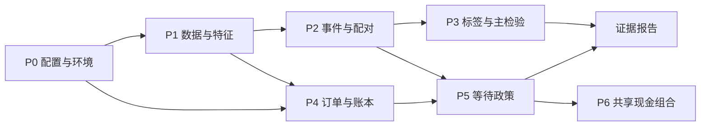

# Martin Luk A 股首次回调 v0.2：实施开发方案

日期：2026-10-14。依据：[最小规则合同审阅页](../momentum_pullback/minimal_contract_v0_2_onepage.md)与[配套操作定义](../momentum_pullback/minimal_contract_v0_2.md)。本文件最初为开发方案，现已按用户授权启动 P0—P2；实际实现与验收以[首批交付记录](../momentum_pullback/P0_P2_DELIVERY.md)为准，下文后续阶段仍为规划。

用户最新分工：实施方开发业务代码，本助手负责策略设计、实施方案及交付后的代码审核和独立验证。下一批以[真实 P1/P2 实施与审验方案](momentum_pullback_next_implementation_plan.md)为准，先补齐预热重置/完整名册边界、来源证据和真实快照接入；原 P3—P6 定义继续保留，不在当前批次实施。

实施修订 **r1，2026-10-14**：按决策截止时刻拆分时间反例，补齐未知根资格的跨日传播、市场日 ADV20、草案运行/检查点身份、公司行动分时点处理、解释器验收及工程试点与统计区间的分离。研究参数仍未冻结。ADV20 的市场日窗口是本次提出的合同补充建议，需显式纳入后续合同版本，不能把旧“所有特征按有效价格观测”的口径默默改写。

首批实施更新 **r2**：ADV20 已显式纳入统一草案配置及绑定文档，保留 PROPOSED。新增首批硬验收：

- **CONTRACT-01** 配置重复键、未实现的匹配解释及文档指纹变化拒绝运行；检查点同时校验合同、代码、历史行情和交易日历前缀、状态内容。
- **DATA-05** 重复或冲突业务键、原始/复权多对多连接、非正/非有限价、OHLC 或复权尺度异常阻断相关计算，不自动 keep-last 或推导因子。
- **STATE-08** 输出按触碰日期筛选；2017 年末根锚点、EMA、观测计数、ADV20 窗口、触碰次数及等待窗口经检查点继承到 2018 年初，与完整回放及独立手工预期一致。
- **OUTPUT-01** 正常零事件、输出覆盖不足、身份未知、资格未知、匹配失败和真实数据阻断分别报告；文件存在不构成成功。

P0 环境验收使用隔离 Python 3.11.9，固定依赖和 wheel 安装来源，完成实际导入与 Parquet 往返。P1/P2 核心逻辑先用合成时序验收；当前真实公共缓存缺少复权因子与 PIT 发布时间/生效绑定，真实事件入口已阻断。公司行动的分时点字段已留在配置接口，应用顺序及订单时点反例属于 P4 前验收，首批不宣称通过。

## 1. 实施目标与推进顺序

先交付可以逐条追溯的事件及对照样本，再检验信息含量，随后验证订单、现金和等待政策。第一阶段的验收标准是因果时点、事件身份和数据分母正确，不以收益高低验收。

建议形成三个交付批次：

- **批次一：P0—P2，工程最小版本。** 配置和数据接口、特征、趋势状态机、固定匹配关系、合成反例测试。真实数据仅审查覆盖与事件数量，不生成未来收益报告。
- **批次二：P3，唯一主检验。** 规则、来源、覆盖门槛及统计口径完成冻结后，计算 10 日条件总回报差与日期块区间。明确它是信息含量诊断。
- **批次三：P4—P5，政策可执行性研究。** 固定订单、逐日股数现金、公司行动、立即买入与等待政策的同起点比较。共享现金组合 P6 作为后续独立里程碑。

P4 的纯函数和构造账本测试可以在 P3 统计之前完成；真实收益运算仍遵守合同冻结要求。PIT 行业或公司行动暂缺时，可以继续合成测试和缺口审查，不能替换成当前分类或简单复权收益后公布主结果。



## 2. 参数状态与开发前需要闭合的口径

买入限价上浮 **1%**、收盘 **≤EMA50** 重置、**10 日条件总回报差**作为主检验，均按用户提供的建议值设计接口，仍标记 `PROPOSED`。匹配 3 个控制、0.20 卡尺、40 日块、2,000 次和随机种子同样留在配置中。当前不填 `freeze_timestamp`，不修改旧 v0.1 YAML，不声称任何值已获确认。

P0 用一个版本化配置收拢这些定义，额外明确以下工程歧义；一旦决定，先写入合同版本再执行真实收益计算：

1. **A 的首次组窗口。** 建议与策略候选一致，要求首次触碰在根锚点 a+1 至 a+20；窗口外首次成功触碰保留为诊断组。若要研究不限窗口的首次信息，应显式另定分组，而不是在代码中任选。
2. **排名与匹配分母。** 建议强势组使用动量降序、代码破同分，取完整有效股票池的 `ceil(0.20×N)`；匹配协变量使用同一完整有效股票池的平均秩百分位。不得把排序取前 N 与百分位阈值混用。匹配前不能因为后续标签缺失重新排名。
3. **价格观测与流动性窗口。** 20 个复权单期收益的样本标准差 `ddof=1`，需要 21 个有效价格观测；63 日动量按合同的 63 个有效观测间隔计算。记录窗口跨越的市场交易日长度。ADV20 单独建议使用截至信号日 t 已完成的 20 个市场交易日，即 t-19 至 t；已验证全天停牌且无冲突证据的成交额在衍生流动性观察中记零，未知缺失不填零，窗口不满或必要成交额未知时 ADV20 不可评估。价格指标跳过停牌不意味着 ADV20 也跳过停牌。
4. **总回报口径。** 建议价格标签采用税前、未扣交易费、股息保留现金而不再投入的标准化假想持仓；应收与现金到账分开。此处需纳入配套定义，不能未经核验就把 `adj_close/adj_open-1` 命名为精确总回报。
5. **两个信息截止点。** `signal_cutoff` 固定特征、事件和配对，`order_decision_cutoff` 固定拟提交订单；每个字段均满足其使用环节的 `available_at≤cutoff`。次日竞价前已经发布的公司行动、报价或资格信息，可以按预定规则更新尚未冻结的订单，但不改写前晚的信号和匹配。最终开盘和随后行情不能反向决定原订单。冻结后的 P/Q 和决策快照不可覆盖；合法的新撤单/拒单通知另记命令及确认时点，不能追认“原订单不存在”。
6. **统计门与经济门。** 预先登记匹配/标签最低覆盖率、独立日期块数量及功效目标；A 的功效目标效应量与 B 的最低成本净增量分开。未登记字段保持 null，真实统计入口拒绝运行；不先看结果再选阈值。

这些是需要落实到代码的口径补充，不要求今天把全部研究参数自动冻结。

## 3. 代码边界与现有组件的使用方式

新增实现集中在 `momentum_pullback/`，用一个拟新增 `scripts/run_momentum_pullback.py` 入口编排；不接入现有 `run_research.py` 的组合路径。

拟新增文件按职责分为：

- `contracts.py`：配置校验、研究版本、状态枚举及事件/订单/批次数据结构。
- `data_adapter.py`、`features.py`：本地有界读取、来源时间、完整分母、滚动与 EMA 特征。
- `event_engine.py`、`matching.py`：逐证券状态转移与只使用信号日信息的固定配对。
- `labels.py`、`inference.py`：公司行动总回报、成熟状态、日期等权统计与块重采样。
- `orders.py`、`execution.py`、`ledger.py`：事前定量、独立开盘撮合、现金和可卖批次。
- `policy_compare.py`：从所有合格周期根锚点发起的两条独立政策路径。
- `portfolio_replay.py`：P6 才实现的共享现金、多候选排序与持仓约束。

这些模块不都在首批编写。先完成配置、数据、特征、事件与匹配模块和合成测试，随后加入标签与交易层，避免把资金分配塞进事件识别。

现有代码经本次只读核查后，使用方式如下：

- `data/panel_loader.py` 可以借鉴分区和字段过滤。新适配器绕开异常后逐文件全扫描/静默跳过路径，禁止自动访问 Tushare；选定分区读取失败必须显式退出。
- `data/universe.py` 可以借鉴 PIT 查找，但当前可用日期主要从月度快照加滞后推导，并存在日历异常时退回自然日的路径。新合同需同时绑定公告可用日和成分实际生效日；不能将该滞后函数直接当作完整成分事件证据。
- `data/industry.py` 存在静态股票信息降级，以及仅凭 `effective_date` 表设置 PIT 标志的路径。新研究要求来源可用时点与历史行业身份，不能因为 `has_pit_data=True` 就跳过审查。
- `data/ashare_boards.py` 只提供板块筛选，未提供完整日期化报价、最小数量与数量步长。订单层另设规则接口，不能统一写死 100 股。
- `sector_panic/rebuild/account.py` 的冻结现金不重复计入 NAV、回执幂等思想可借鉴；单证券 ResearchBook 的 `nav` 属性仅返回现金，不能直接作为多证券估值接口。
- `sector_panic/rebuild/portfolio_book.py` 有明确现金冻结与固定数量，但绑定 P1 费率、预算和名额，部分数量为分数股；不直接导入整套账户驱动。
- `sector_panic/rebuild/execution.py` 是收盘代理，且含历史缺陷开关；新撮合器独立实现开盘模型，不开放“价格低于保护位拒买”参数。
- `sector_panic/rebuild/dependence.py` 的实际区间隔离可借鉴算法和反例；不沿用其板块策略的等待/持有期限。
- `products/lowvol_fees.py` 的既有绑定具有特定年份与证券范围。可以借鉴费用分项和股息税思路，不能作为本策略跨年份费用表。
- `validation/sample_windows.py` 的已查看身份约束继续继承，并记录本策略自身版本、实际冻结时间和已查看终点。冻结不会恢复历史 OOS。

## 4. P0：配置、环境与验收骨架

**输入：** v0.2 两份文档、既有规则登记、本地运行环境。

**拟开发项：**

- P0-01 新建 `contracts.py` 及 `configs/momentum_pullback/research_contract_v0_2.yaml`，明确 `schema_version`、`contract_status`、`outcomes_enabled`、参数状态、字段单位、来源绑定与未完成门。
- P0-02 新建 `tests/momentum_pullback/`，只给新模块提供合成数据 fixture，不修改旧策略测试全局配置。
- P0-03 生成每次运行的 `run_manifest.json`：合同/源文档 SHA-256、代码版本与未提交文件摘要、输入分区清单、数据观测终点、依赖版本、阶段、随机种子、样本身份、门结果和输出摘要。
- P0-04 区分 `DRAFT_SCHEMA_VALID`、`DATA_READY`、`FROZEN_RESEARCH_READY`、`DAILY_EXECUTION_PROXY`；语法可加载不是研究冻结或真实成交证明。
- P0-05 每次草案运行也固定合同、输入内容与计算状态版本。检查点保存 `checkpoint_schema_version, contract_hash, code_behavior_hash, feature_origin, processed_cutoff, consumed_history_hash`；不能仅用路径、文件大小或修改时间替代内容身份。参数或已消费历史改变时拒绝续跑，重建新的草案运行；仅追加严格晚于检查点的未来数据时，也须核验历史前缀未变并生成新的运行清单。新冻结研究按冻结版本重新生成并核对事件/配对，旧草案成果不能直接改状态升级。

**解释器实际发现，仅元数据核验：** 当前终端默认 `python` 为 `C:/Users/cfz/AppData/Local/Programs/Python/Python311/python.exe`、3.11.9，未找到 numpy/pandas/pyarrow 包元数据。显式 `C:/Users/cfz/AppData/Local/Programs/Python/Python314/python.exe` 为 3.14.6，元数据列有 pandas 3.0.5、numpy 2.5.1、pyarrow 25.0.0、pytest 9.1.1；其 numpy 与项目 `numpy<2.0` 要求不一致。两者不能混称为同一个环境，也不能凭元数据存在就认为可运行。

P0 锁定 `sys.executable` 的绝对路径、解释器版本、依赖锁定版本、实际模块路径和安装来源/包指纹；没有安装来源证据的字段记未知。使用同一解释器实际导入 numpy、pandas、pyarrow、yaml、pytest，再在隔离研究临时目录完成小型 Parquet 写入、读回及字段类型/值核验，检查数值与时间戳字段；不写公共行情目录。建议独立研究环境，本轮不升级全局环境；上述导入与读写检查为未来验收项，本轮未执行。

**验收：** 旧 v0.1 配置被新入口拒绝；draft 可以进行合成测试和只读审查，但真实收益入口必须拒绝；源文档或参数改变产生新合同指纹；相同输入重复运行不混写已有成果目录；不兼容检查点拒绝续跑；解释器绝对路径、模块导入和隔离 Parquet 读写必须同时通过，才能声明环境可运行。

## 5. P1：离线数据门与特征

**输入：** 已选择的 Parquet 分区、交易日历、成分/ST/行业身份来源、公司行动来源；读取来源只限明确路径。

**拟接口：** `load_inputs(scope)`、`validate_coverage(inputs)`、`build_features(inputs, contract)`。所有读取和计算可独立测试。

**标准化字段：**

- 价格：`ts_code, trade_date, raw_open/high/low/close, adj_factor, adj_open/high/low/close, amount_cny, volume_shares`。
- 特征：`valid_observations, momentum63, ema21, ema50, ema21_lag5, prior_high20, volatility20, adv20_cny, circ_mv_cny`。
- 身份与质量：`member_from/to, member_available_at, st_status, industry_code, industry_available_at, field_available_at, quality_status, source_id`。
- 开盘证据：报价范围、原始开盘、停牌状态、该状态实际可用时点；与信号输入分开存放。
- 公司行动：`action_id, announced_at, entitlement_record_at, price_basis_effective_at, quantity_effective_at, delivery_at, sellable_from, cash_payable_at, cash_received_at, source_id, verification_status`；权利、估值单位、实际交付股数、可卖股数和现金分别记录，未验证时点不能统一填除权日或支付日。
- 流动性质量：`adv20_window_start/end, verified_halt_days, unknown_amount_days, amount_origin`；停牌派生零值必须可追溯，不能回写原始行情。

单位转换为 `amount_cny=amount×1000`、`volume_shares=vol×100`；`circ_mv_cny=circ_mv×10000`。[Tushare 每日指标文档](https://tushare.pro/document/2?doc_id=32)说明流通市值为万元、当前更新窗口为交易日 15—17 点；这只能支持当前字段语义，不能补造历史逐行发布时间。

**关键行为：**

1. 成分条件同时满足 `available_at≤signal_cutoff` 和有效期覆盖当日；没有可用历史种子就不构造早期完整股票池。
2. 先确定历史资格和预热排除，再审查每个应有成员的输入。对尚缺但理应存在的价格不缩小排名分母，该日标记 `RANK_DENOMINATOR_INCOMPLETE`；强势/根事件资格使用 `KNOWN_ELIGIBLE/KNOWN_INELIGIBLE/UNKNOWN`，未知不能默认为不合格。可能漏掉根事件的影响按 P2 状态传播，不只跳过当天。
3. 官方停牌可跳过新价格观测，未知缺价不能当停牌。历史断层会使首次身份未知，不能恢复读取后从 touch_no=0 继续。ADV20 则保留 20 个市场日分母，只有已验证全天停牌的对应成交额可派生为零；部分停牌不按全天零处理，已知停牌与非零成交证据冲突时输出数据冲突，未知成交额不以更少日期的平均代替。
4. EMA 使用统一历史起点或完整状态检查点，不在每月/每年重新初始化；前 20 个有效最高价必须排除当前日；动量与波动按股票隔离。
5. 股票批次建议 80 个，月度有界读取并保留跨月 EMA、滚动窗口和身份状态；同日排名必须在全部有效成员特征汇齐后计算，不按批次分别排名。
6. 公司行动适配分别服务总回报标签和实际账户；复权比例不自动代表真实可交付股数或现金到账。按事件各自的发布/生效/到账时间输出可用于不同截止点的信息视图；接口首批保留这些字段，账户应用次序在 P4 验收。

**输出：** `input_manifest.json`、`coverage.parquet`、`data_gaps.parquet`、`features.parquet`、`state_checkpoint.json`。原始文件和公共缓存只读。

**验收：** 缺一个必要成员导致当日排名阻断并记录后续身份依赖；截止点后发布的行业记录不可进入既有匹配；自然日不代替交易日；80 股批次与其他批次划分结果一致；合同和已消费历史相同的检查点续跑与一次回放一致；信号截止点后的信息不改变此前特征。停牌零成交额进入市场日 ADV20 的固定分母，未知缺失使相关流动性窗口不可评估。

## 6. P2：事件状态机与固定配对

**输入：** 通过相关数据门的特征与资格状态，不读取未来收益或交易结果。

`TrendState` 至少保存 `identity_known, root_qualification_status, uncertainty_since, uncertainty_reason, reset_observed_at, trend_id, root_anchor_date, root_breakout_id, touch_no, in_touch_segment, window_closed`。根锚点、额外突破、触碰与可交易候选分别记录，不用一个 signal 字段覆盖全部历史。

**未知资格的跨日传播：** 等待根事件期间若出现价格突破，但排名/成员等必要资格未知，且其余已知条件不能排除合格根锚点，则转为 `ROOT_IDENTITY_UNCERTAIN`。随后数据恢复也不得直接在下一次突破开启一个“首次”周期；须重新观察到有有效价格与 EMA50 支撑的合同重置，或在修复历史内容的新运行中从此前确定状态完整重算。缺失后估算出的 EMA50 不能冒充有效重置证据。

若根周期早已确定、必要价格历史完整，排名缺失只让当日候选资格未知，仍记录可确认的触碰区段与次数，不清空根身份，也不在恢复后补发首触信号。缺失的是仅用于匹配的行业字段时，阻断匹配，不自动污染已经可确定的价格周期；某必要根条件已明确为假时，保留已知不合格，不把所有股票一律置为身份未知。

**处理顺序：**

1. 先处理未知断层和 `close≤EMA50` 周期失效。
2. 有已观察重置、无活动周期，且强势与严格突破成立时开启根周期；根日不计回调。
3. 活动周期更新触碰区段；从非触碰转为触碰时只增一次 `touch_no`。连续触碰不重复发候选；至少一日 `low>EMA21` 后方可形成下一段。
4. 根后第 1—20 日内，编号 1 的触碰首日收复并保持资格才成为首次候选；失败、同股持仓冲突和窗口外事件保留原因。
5. 周期内再突破记录 `breakout_id`，不重置编号或根预算；第 20 日先判断首触，再处理超时。离开指数或 ST 不自动重置趋势身份；若后续行情无法验证，身份另记未知。

事件识别保持为价格和身份函数。持仓/待卖状态作为后续订单抑制原因另存，不能让第一次被资金挡住的事件从历史中消失。

**输出主键与状态：** `event_id, ts_code, trend_id, breakout_id, root_date, signal_date, root_age_sessions, touch_no, touch_segment_id, reclaim_pass, eligibility_pass, information_cutoff, event_status, reason_codes, contract_hash`。ID 使用版本、证券和真实日期确定生成，不能依赖处理批次或随机序号。

匹配由 `matching.py` 处理：同日同已知行业，按合同四个百分位维度等权平方距离；严格卡尺，取不同代码的最近三只、代码破同分。普通强势组排除所有当日触碰区段；资格未知不冒充普通组。对照不足不放宽、不补人，记录匹配失败；跨事件复用次数完整输出。

**输出：** `trend_cycles.parquet`、`breakouts.parquet`、`touches.parquet`、`events.parquet`、`matches.parquet`、`match_failures.parquet`、`covariate_balance.parquet`。匹配到此锁定，标签缺失或后来未成交不得更换对照。

**验收：** 起点未知不标首次；潜在根资格未知后数据恢复不能伪造新首回调；已有确定根且价格完整时继续记录触碰；首触失败后再突破仍是后续回调；连续触碰不重复计数；第 20 日成功首触保留；趋势失效先于当日触碰；信号截止点之后的信息不改变已生成事件与匹配；同股持仓抑制订单但不改变触碰编号。

## 7. P3：总回报标签与唯一主检验

**进入真实统计前的门：** 合同相关取值与 P0 补充定义定稿，输入来源绑定、覆盖/功效门登记完毕，固定本次研究身份。draft 只运行合成测试；不能把后续收益结果用来填写这些门。

另行预登记 P3 的研究区间及选择理由、有效事件/配对日期、40 日块下可用时间信息与功效门槛。2018 年第一季度只承担工程试点，不能自然升级为统计验证样本；重叠移动块的可抽取数量和 2,000 次重采样不能当成独立原始信息量。报告时间跨度、事件日期分布和近似非重叠块信息；样本或功效门不足时输出 `INSUFFICIENT_STATISTICAL_INFORMATION`，不公布有优势/无效的策略结论，也不根据收益表现改选研究区间。

`labels.py` 按固定匹配名单计算 t+1 原始开盘至 t+H 收盘的标准化总回报，H 为 5/10/20。H 的计数严格按市场交易日。价格标签不受限价是否成交、实际提前退出或当前持仓影响。

公司行动经已验证合同处理股份、应收和现金；如果只拿到复权价比，只能输出另名的复权价格诊断，不得替代合同的总回报主标签。对照标签缺失时不换对照，也不改为剩余两只平均。

状态至少区分 `COMPLETE, NOT_MATURED, DATA_UNVERIFIED, CA_UNBOUND, MATCH_FAILED`；保留全部原始事件分母和每一步损失分母。不将缺失标签置零；达到缓存尾端也不当作完成观察。

主统计严格按三步计算：

`d_event = R10_first - mean(R10_control_1, R10_control_2, R10_control_3)`；

`d_date = 当日完整配对的 d_event 等权平均`；

`primary_effect = 有完整配对事件日期的 d_date 等权平均`。

只有在预先规定覆盖门成立时，才解释该完整配对子样本结果；另报告未完成事件、匹配不足及缺失选择风险。完整日期表中“无事件日”和“有事件但不可评估日”是不同状态，不能统一填零。

`inference.py` 使用完整、连续市场交易日索引的 40 日移动块，块内保留证券、行业、固定配对及事件重叠；重复抽到一个日期就重复该日期全部事件。没有事件的日期保留时间距离，但不被当作零增量纳入主均值。2,000 次、固定种子、95% 区间按合同执行；20/60 日块仅作已登记稳健性。无有效事件的重采样标记无效，不暗中无限重抽；最低有效块/重采样比例必须提前登记。

**输出：** `fixed_horizon_labels.parquet`、`event_deltas.parquet`、`date_deltas.parquet`、`bootstrap_summary.json`、`primary_test.json` 和可追溯报告。字段名明确 `gross_total_return_information_effect`，不能写成 net alpha。

**验收：** 用手算样本证明“先同日平均、再日期等权”区别于事件等权；更换未来成交状态不改变信息标签；同股票/行业的成组行情在重采样中一同保留；缺标签不补零、不替换控制；相同输入和随机种子完全复现。

## 8. P4：事前订单、开盘撮合与股数现金账本

拟接口分别为 `build_frozen_order(decision_inputs)`、`match_open(order, opening_evidence)`、`apply_fill(book, fill)`、`mark_book(book, valuations)`。撮合器没有重算信号或数量的入口。

事前限价 P 按建议值 `raw_close×1.01`、合法价格单位向下取整和已知报价范围确定。数量 Q 根据 P、前收盘 NAV、现金、初始位 S、费用预留、流动性、名额及板块数量规则计算；不能使用最终开盘 O。报价约束只允许在事前合同规定决策点校验，之后订单字段冻结。

基础数量约束为：`Q×max(P-S,0.08×P)≤0.0025×NAV_t`，另受单股/行业/总敞口、ADV 和整手约束。该风险公式沿合同为价格损失预算，实际费用另扣并报告，不能称为实际亏损上限。Q 取合法且含费用预算足够的最大数量。

买入撮合：O≤P 且证据允许时按 O 的代理价格处理；O≤S 仍保留成交，不取消、不临时减 Q；O>P、停牌、涨停排队无足额证据或未知状态分别返回不同状态。每边 10 bp 摩擦作为单独支出，不能通过抬高成交价突破买入限价。5/20 bp 场景沿同一信号规则，费用预算可导致数量不同并明确归因，不挑选最优参数。

卖出按真实可卖批次和事前合法限价撮合，跌停开盘不假设排队成交；持续 pending 不删除持仓。开盘代理与余单撤销都标记 `DAILY_EXECUTION_PROXY`，没有真实成交回执或容量证据时不宣称已验证可交易。

账本至少包括：`CashBook(total_cash, buy_reserve, available_cash)`、`Lot(lot_id, ts_code, buy_date, sellable_from, shares, stop_raw)`、`Receivable`、`FrozenOrder`、`Fill`、`ExitIntent`。现金使用 Decimal 或整数分，证券数量与零股单独处理。

单日处理按已知信息和实际生效时点驱动，不能把全部公司行动统一安排在开盘后：

1. 从各事件的 `announced_at` 判断当前可知信息；按已验证登记时点确认权利，按实际到账时点登记现金，权利应收不提前变为可用现金。
2. 订单决策前应用已经生效的除权价格尺度、保护位转换和已交付股份；根据 `sellable_from` 更新可卖批次。尚未交付或尚未可卖的新增权益单独登记，不能把全部送转权益立刻当作可卖股数。
3. 用更新后的价格尺度和可卖股数校验尚未冻结订单，固定 P/Q 与资金预留；前收盘 NAV 保留其已验证经济口径，不以新增股数乘旧股价重复放大 NAV。历史已冻结订单保留原内容，新取消/替换命令独立记录并等待合法确认，不追认未成交。
4. 进行开盘撮合、成交入账和模拟余单撤销；本次开盘卖出款与低开节省现金不回用于已经冻结的买单。
5. 继续按日内/盘后实际时点处理交付、可卖和现金到账，再执行收盘估值、权利确认及后续信号/退出意图。时间证据或价格/股份合同不足时阻断相关操作，而不是移动到方便的处理阶段。

开盘前已生效的数量和尺度不得延后至撮合后；盘后才到账的现金也不得用于当日竞价。P1 先保存分离时间字段，P4 再用构造场景验证应用次序。

费用、股数、保护位、股息应收与到账分别更新；实际账户不能沿用价格标签的“假想一股”口径。缺少估值或税费合同只保留状态，不生成假的完整 NAV。被动涨价导致超限先阻止新买，不新增未经定义的强制减仓规则。

**验收：** 低开不改订单；含费现金不为负；冻结现金不重复计入 NAV；重复回执不重复增股/扣款；买入日不可卖；开盘至首日收盘损益进入 NAV；未卖出的仓位保持占用；缺价不记零损益；公司行动不重复派股、派息或撤销已成交事件。

## 9. P5：同根锚点的等待政策比较

每个事前合格周期根锚点都建立立即入场和等待首次候选两个独立袖套，初始现金相同，均使用 P4 的风险算法、报价、费用及退出规则。立即组 S 为根日最低价；等待组 S 为首触信号日最低价，数量可不同。

等待失败、超时、限价未成交、状态未知等完整保留；合法未入场为现金路径，数据不完整另记不可评估。已观察期限足够的现金路径可以是零收益，但不能把不可评估路径也填零。

共同观察日定义为 `calendar.shift(root_date,41)` 的收盘，计算两组现金、应收和可验证持仓标记价值差。未平仓仍输出 `OPEN_POSITION/EXIT_PENDING` 并继续跟踪，不在 a+41 强制平仓，不把标记价值当成交现金。费用和税合同未绑定或共同日缺估值时不计算净政策差。

持有第 19 日收盘产生第 20 日开盘目标卖出意图；等待末日 a+20 触发、a+21 买入时，目标退出为 a+40 开盘。此处提供明确计数反例，以防 a、t、b 的偏移混用。受阻后的实际退出可以超过 a+41，真实交易标签结束日和共同标记比较日分别记录。

**输出：** `policy_roots.parquet`、`policy_orders.parquet`、`policy_fills.parquet`、`policy_nav.parquet`、`policy_outcomes.parquet`、`actual_trade_labels.parquet`。每个根锚点两条路径都必须能找到，包括失败与未完成状态。

实际交易训练/评估按真实标签区间隔离，未平仓标签不进入已完成收益训练；a+41 标记标签按其自身观察日处理。B 若需要区间估计，先登记针对政策标签重叠的统计口径，不直接照搬 A 的 40 日块与显著性结论。

**验收：** 无回调等待组保留现金；最晚触发的日期计数正确；立即组低开破 S 仍成交；等待后未成交不删除根锚点；两袖套在同一日期比较；共同日未平仓不当作平仓；独立袖套不能相加生成可执行组合。

## 10. P6：共享现金组合，作为后续独立里程碑

只有前述样本和订单账本正确后，才实现候选排序、最多八只、现金预留、行业限制和同股持仓抑制。立即/等待组合在相同账户资本与约束下各自回放，而不是把独立袖套平均当组合。

候选排序使用已知动量、ADV20 降序、代码升序；待卖持仓继续占用现金以外的风险/名额约束，不能预支尚未成交卖出款。报告实际现金和敞口、净值、回撤、风险预算占用、订单失败、压力场景损失、有效资金表现及收益集中度。

验收“第九个候选、卖不出仍占位、资金不足无法整手、同行业上限、价格漂移后超限”的完整场景。真实竞价容量、分钟撤单和实盘执行不属于 P6 默认代理回放证明，需独立证据。

## 11. 核心反例测试清单

以下是拟验收用例，不是本轮已经运行的测试：

- **DATA-01** 一个应有成分价格缺失，排名不能对剩余成员继续生成。
- **DATA-02** 公告晚于信号或成分尚未生效，不得提前使用。
- **DATA-03** 当前行业回填和自然日降级均拒绝；停牌事件与未知缺价区分。
- **DATA-04** ADV20 的 20 个市场日内有已验证全天停牌：该日派生零成交额仍进入分母；同位置换成未知缺失时拒绝计算，不用 19 日平均。
- **TIME-01** 修改 `available_at>signal_cutoff` 的信息，已固定特征、事件与配对不变；不按日历 t+1 笼统判定所有信息均不可用。
- **TIME-02** 修改 `available_at>order_decision_cutoff` 的最终开盘及后续行情，已冻结 P/Q、预算和决策快照不变；撮合结果可以变化。
- **TIME-03** 公司行动或合法报价在次日订单截止点前已发布并已适用，尚未冻结的订单可按预定规则更新；将同一消息发布时间移到截止点后，不得反向修改原订单。合法撤单另记命令/确认，不覆盖原订单内容。
- **STATE-01** 首个有效价格已经在 EMA50 上方，但未观察重置，不标首次。
- **STATE-02** 首触失败→周期内再突破→再次触碰，编号为 2。
- **STATE-03** 连续三日触碰只形成一段；一日 low>EMA21 后再次触碰才加编号。
- **STATE-04** a+20 成功首触允许候选；a+21 首触不发首次策略买单。
- **STATE-05** 当日 close≤EMA50 的失效优先；同股持仓/待卖只阻止订单，不删除状态。
- **STATE-06** 尚无确定根时，某潜在突破日排名未知→次日排名恢复→再突破/触碰，首次身份仍未知；有效重置后才重新允许根事件。
- **STATE-07** 根周期已知、价格完整、某日排名未知：当日触碰继续消耗真实编号，数据恢复不清空次数或补发首触候选。
- **MATCH-01** 不足三只不放宽；百分位卡尺边界、距离并列与复用记录确定。
- **MATCH-02** 对照将来缺标签或未成交，不能回头换人。
- **LABEL-01** 缓存尾部 10 日未成熟、停牌终值未知、公司行动缺合同均有独立状态。
- **LABEL-02** 送转后假想标签总资产连续；股息应收不重复作为到账现金。
- **STAT-01** 两日事件数量不同的手算样本检验日期等权，非事件日不作为零差值。
- **STAT-02** 同日行业/股票和相邻日期依赖按整块保留，固定种子复现。
- **ORDER-01** 构造 S=10、P=10.10、O=9.80，既有订单仍按固定 Q 模拟成交。
- **ORDER-02** O>P 不成交；买入涨停和卖出跌停不能假定队列成功。
- **CASH-01** 同次开盘卖出款和低开节省现金不可扩大已经固定的买单。
- **LEDGER-01** 首日损益、费用、预留现金、T+1 批次、回执幂等共同验证。
- **EXIT-01** 第 20 日无法卖出，第 21 日后仍有持仓与待卖单；实际标签不硬截断。
- **POLICY-01** 全部合格根事件均有两路径，合法现金、不可评估和未成熟不混用。
- **CA-01** 买入后公司行动不删除成交，不重复派股派息；未知股份可卖日不能当作已可卖。
- **CA-02** 开盘前已生效送转/除权需先更新保护位尺度、已交付数量和可卖批次再校验订单；仅有权利或盘后交付的新增股份不得提前卖出，盘后到账现金不得提前用于竞价。
- **ENV-01** 用锁定绝对路径的解释器实际导入必要模块，再执行隔离 Parquet 往返；仅有包元数据不构成通过，探测不写公共行情目录。
- **REPRO-01** 检查点合同、计算版本或已消费历史内容不一致时拒绝续跑；合法的未来追加也要验证历史前缀不变并记录新运行身份，旧 draft 匹配不能直接升级研究状态。
- **SAMPLE-01** 工程季度没有事件/完整匹配时，分别报告覆盖缺口、身份未知、规则稀疏与匹配失败；统计日期块/功效不足不标成策略无效。
- **E2E-01** 相同数据分区和配置，分批/重启/重复运行输出一致；输入分区不被改写，任何网络获取入口触发即失败。

## 12. 拟新增命令与成果组织

下列入口尚不存在，是开发完成后拟支持的操作形式，不作为现在可运行命令交付：

```powershell
$pullbackPython = '<已验并锁定的研究环境 python.exe>'
& $pullbackPython scripts/run_momentum_pullback.py contract-check --config configs/momentum_pullback/research_contract_v0_2.yaml
& $pullbackPython scripts/run_momentum_pullback.py audit-data --config configs/momentum_pullback/research_contract_v0_2.yaml --start 20180101 --end 20180330 --offline
& $pullbackPython scripts/run_momentum_pullback.py build-events --input-manifest '<已验数据清单>' --outcomes-disabled
& $pullbackPython scripts/run_momentum_pullback.py lock-matches --events '<事件文件>' --outcomes-disabled
& $pullbackPython -m pytest tests/momentum_pullback -q
# 合同及数据门满足后，才开放以下真实收益操作。
& $pullbackPython scripts/run_momentum_pullback.py conditional-study --run-manifest '<已冻结研究清单>'
& $pullbackPython scripts/run_momentum_pullback.py compare-policies --run-manifest '<已冻结研究清单>'
# 后续共享账户里程碑。
& $pullbackPython scripts/run_momentum_pullback.py portfolio-replay --run-manifest '<已冻结研究清单>'
```

首个真实数据批次建议固定 **2018 年第一季度**，只作为开发与覆盖样本，未经收益筛选，不是 OOS，也不是 P3 默认统计区间；特征和身份从统一可验证历史起点预热。首批关闭收益标签；后续已登记的研究区间才另外读取必要的标签/政策观察尾部。若数据门失败，输出缺口，不自动改用表现更好的年份或板块。事件或匹配稀少需拆解数据覆盖、首次身份未知、规则稀疏和匹配失败，不据一个工程季度判定策略有效或无效。

衍生成果保存在 `data/research/momentum_pullback/<run_id>/`，报告保存在 `reports/momentum_pullback/<run_id>/`。`run_id` 绑定合同指纹、阶段、数据清单和观测终点；一个运行不覆盖另一个运行。生成 manifest、质量门、日志、事件/标签/订单文件及校验摘要，记录现金利息基准、费用版本和实际模型边界。

结果状态分开报告：工程验收通过、数据可评估、信息增量证据、代理政策净差、共享账户结果。测试通过不升级样本身份；日线政策净差不升级成真实成交能力。

## 13. 首个交付的具体验收包

第一项实施应是 **P0—P2**，形成：

1. 版本化 draft 配置和配置校验器、解释器/依赖/安装来源记录，三个研究选择仍有明确状态；未来环境导入及 Parquet 往返验收明确。
2. 本地有界覆盖报告及字段时点/单位合同，价格与市场日 ADV20 窗口分离，公司行动分时点字段齐备，不修补公共缓存。
3. 可复现的 EMA、动量与排名特征，带合同、计算版本和已消费历史身份的跨月状态检查点。
4. 根周期、突破、回调和候选四层事件文件，未知资格的跨日影响与失败原因完整。
5. 固定匹配名单、覆盖与协变量平衡，尚不生成收益标签。
6. DATA/TIME/STATE/MATCH/ENV/REPRO 类首批反例通过，并有失败即阻断的集成检查；公司行动应用顺序在 P4 前另行验收。

这批交付后可以逐事件审查“首次”是否被正确识别，确认数据是否足以支持合同，再进入 P3。AVWAP、扩展市场、优化限价、复杂退出和参数网格不进入首批开发。
