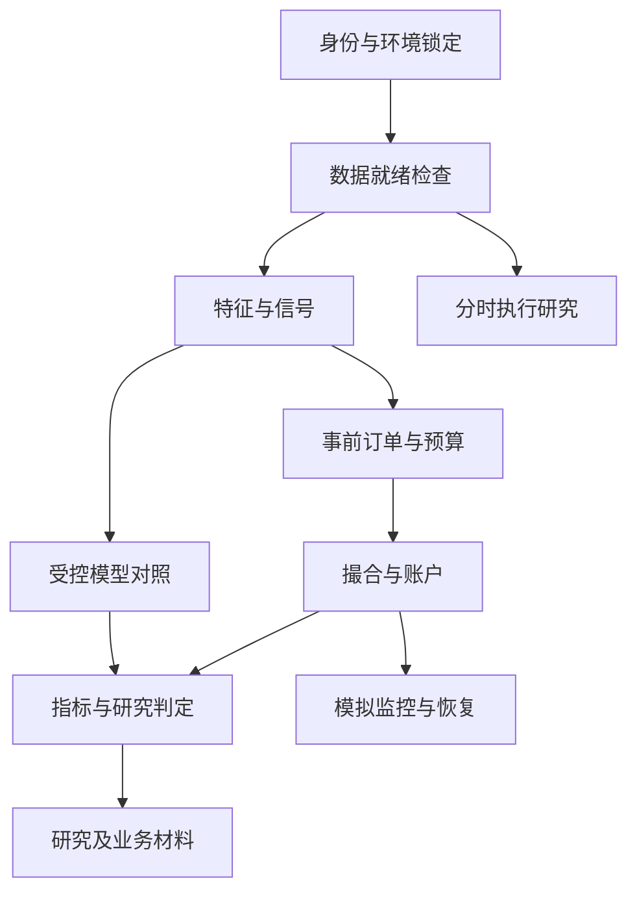

# 平安证券量化策略研究岗：定向补齐完整实施方案 v1

日期：2026-10-19。对应岗位：[量化策略研究 · 1983587823](https://www.liepin.com/job/1983587823.shtml)。

状态：**方案完成，尚未实施。** 本文件只针对该岗位。评估依据见[本岗位报告](C:/Users/cfz/Workspace/ProjectQ/code_v4/reports/liepin_1983587823_research_fit_20261019.md:1)。本轮仅编制方案、读取相关代码与 ETF 字段，不安装依赖、不获取新数据、不修改业务代码、不运行策略实验。

## 1. 实施目标与交付边界

目标是形成一套本人能解释、可复现、可检查的量化研究作品集，覆盖 Python、数据、因子评价、回测、ETF 研究、交易约束、风险监控及业务表达；再依据数据条件扩展执行研究与 ML。

交付分两层：

- **核心交付 v1：M0—M4 与 M8。** 固定环境和输入，核查选定路径正确性，完成 ETF 数据门与研究基线，整理完整研究案例、技术说明和业务摘要。若真实 ETF 数据门未通过，交付明确的阻断清单、已完成工程和历史案例，ETF 真实经济评价保持未完成。
- **条件扩展 v2：M5—M7。** 分时执行基线、模拟监控、TensorFlow 对照。各模块按前置数据和任务成熟度分别进入，不要求为完成作品集一次性建设全部系统。

验收分开记录工程正确性、数据就绪、经济证据、展示掌握程度和运行模式。工程通过不保证 Alpha 有效；模式只允许离线、回放或模拟。本方案不包含真实账户部署，也不能生成三年以上行业履历、真实账户历史或客户服务经历。

当前按求职作品集优先安排。个人学历、行业年限、可披露的外部实盘及协作材料尚未提供，在 M0 登记为履历核验项，不阻断离线基础工作。实际面试时间和数据预算也未提供，工期仅作投入估计。

与评估报告优先级对应：P0 为 M0/M1 及既有案例整理，P1 为 M2—M4，P2 为 M5/M6，P3 为 M7，M8 负责统一交付；M 编号表达工作包与依赖，不改变原优先顺序。

## 2. 已核对的项目现状

以下事实用于确定改动范围，不作为全仓验收：

1. 数据、因子、组合、回测与验证已有分层；现金预留、订单生命周期与恢复可参考重建账本。已有历史成果适合复用作研究案例。
2. 2026-10-18 定向执行 158 项测试，137 通过、21 项因缺少依赖或导入链失败未通过；另一次测试收集因缺少 dotenv 中断。该记录不是本方案新测，也不是 21 个已定位算法缺陷。
3. `.venv-pullback` 为在研任务环境，不能直接当完整项目环境。根依赖有 `numpy<2.0` 约束；已探测的 Python 3.14 环境不满足该约束。新演示环境单独创建与锁定。
4. 本次读取 `fund_daily` 的 8 个年度文件元数据与证券代码列：共 18,833 行，目录年份为 2017—2024。2017、2018 年各出现 9 个代码，2019—2024 年各出现 10 个代码；512480.SH 首次在所读文件中出现于 2019 年。首次缓存记录不等于正式上市日期，不能据此补造历史资格。
5. ETF 缓存字段含 `open/high/low/close/pre_close/vol/amount`，没有在这些文件中发现公司行动或复权字段；是否有其他可用事件源需 M2 核验。该检查没有证明逐日完整、单位正确或公司行动已处理。
6. [现有 ETF 入口](C:/Users/cfz/Workspace/ProjectQ/code_v4/scripts/run_product_backtests.py:175) 只保留收盘价，计算 60 日收益/20 日波动评分；其波动窗口允许不足 20 个观测。所谓周频由 `weekly_rebalance_dates` 实现为每 5 个可见交易日期，并非自然周末。
7. [现有 ETF 回放](C:/Users/cfz/Workspace/ProjectQ/code_v4/products/weekly_long.py:511) 在 `exec_lag=1` 下读取滞后日期的收盘价；属于滞后收盘代理，不能描述成开盘成交。输入日期来自可见 panel，完整交易日历与未知缺行要另行核验。
8. v6 ETF 归档为 `ECONOMIC_PASS_NOT_STRATEGY_GO`，窗口是机制诊断；r8 的三个低波指数对照为 `DATA_INSUFFICIENT`。分别保留身份，不覆盖归档或将某一版本判定泛化。
9. 股票周期引擎有协方差截止、开盘成交与收益起点等静态疑点；基础执行器保存 T+1 参数，不等于按批次实现可卖数量。需按实际调用路径复现，不预先判定所有引擎均有同一错误。
10. [样本身份](C:/Users/cfz/Workspace/ProjectQ/code_v4/validation/sample_windows.py:16) 与 [配置](C:/Users/cfz/Workspace/ProjectQ/code_v4/configs/sample_windows_v1.yaml:1) 已记录历史查看和冻结范围。加入新策略、ETF 或模型不能使旧历史重新成为独立 OOS。

## 3. JD 到工作包的映射

- Python、Pandas/Numpy、独立回测：M1 的环境、接口和正确性，M8 的本人演示。
- 因子库、多因子与研究方法：M4 的因子案例、样本与实验登记，以及可复现研究结论。
- 股票/ETF 策略：M2 数据合同、M3 ETF 账户与基线、M4 对照和稳健性。
- VWAP/TWAP/IS 与智能执行：M5 先建立真实可评估的基线；AI 增强需在基线与样本成立后另定增量实验。
- 实盘监控：M6 补模拟账户的追踪、对账和恢复证据；真实账户经历独立核验。
- TensorFlow 等 ML：M7 做受控对照，真实工具掌握程度在 M8 现场演示。
- 风控、业务协同和沟通：M3/M6 的技术约束、M8 的技术与业务说明。券商内部合规流程和真实客户经历独立核验，不用文档样稿冒充。

## 4. 架构与复用原则

采用现有目录分层，加薄交付编排与缺失的领域模块。岗位编号仅用于配置、输出和证据身份，业务计算模块使用业务名称。不为作品集引入微服务、分布式调度或通用插件框架。



现有模块的处理方式：

- `data/parquet_cache.py`、`data/calendar.py`：经测试复用规范文件选择、严格读取与日历；新适配器不得静默跳过异常或触发在线抓取。
- `factors/cross_section.py`、`eval/cs_evaluator.py`、`validation/walk_forward.py`：复用适合的评价和切分接口，逐一检查输入时间口径。
- `products/weekly_long.py`：保留旧诊断路径，复用经核验的纯函数及回归案例；新的股数账本与开盘代理使用单独入口。
- `sector_panic/rebuild/portfolio_book.py`：参考预算预留、事实与账户的分离，不把其归一化份额、冻结费率和策略特定逻辑直接套到 ETF。
- `live/risk_gate.py`、`live/photoresist_panic/journal.py`：复用风险和幂等设计；策略专属状态机通过适配隔离，不直接驱动新账户。
- `scripts/run_frozen_product_compare.py`：参考摘要与清单格式，不通过修改其全局目录运行新任务，不覆盖旧 `RUN_ID`。

拟新增文件，均尚未创建：

```text
research_delivery/
  contracts.py          运行身份、分项状态及工件约定
  provenance.py         消费输入与源码清单、校验和及续跑验证
  readiness.py          组合各领域数据门，不包含策略逻辑
  runner.py             离线阶段编排与错误传播
data/etf_research_adapter.py
products/etf_rotation.py
backtest/etf_ledger.py
execution_research/
  contracts.py
  baselines.py
  metrics.py
live/research_monitor.py
alpha/tf_baseline.py
scripts/run_research_delivery.py
scripts/run_execution_study.py
scripts/check_research_delivery.py
configs/research_delivery/pingan_1983587823_v1.yaml
tests/research_delivery/
```

先实现 M0/M1 必需的最小文件；M5—M7 文件在对应阶段才创建。若现有接口通过核验即可复用，减少新文件，避免复制框架。改动公共模块时保持既有入口兼容，通过适配和版本化隔离新合同。

## 5. 运行身份、数据与工件合同

### 5.1 运行身份

每次运行记录 `run_id`、合同版本、创建时间、模式、环境锁定摘要、源码清单、配置摘要、输入清单、研究身份与父运行。源码清单包含实际消费的未提交文件，不能仅记录 Git HEAD。清单排除凭证与无关个人文件。

研究身份至少含 `freeze_timestamp`、`viewed_start/end`、查看记录、实验编号、参数与评价协议版本。模式只允许 `OFFLINE`、`REPLAY`、`PAPER`；真实账户权限保持禁用。本方案中的候选参数不是冻结记录。

### 5.2 数据合同

- 所有时间明确为 Asia/Shanghai，并保留可比较的带时区时间戳；`trade_date` 只作交易日键。
- 区分 `event_time`、`published_at`、`available_at`、`ingested_at`、`signal_cutoff`、`order_decision_cutoff` 和 `earliest_fill_time`。只有采集时间不能证明历史可得。
- 日线主键为证券、交易日；行情保留原始 OHLCV/amount、价格尺度、单位、来源与文件身份。
- 证券主数据含上市/退市、类型、交易单位、价格步长、交易及可卖约束的生效区间；基金价格、复权或总回报、分红与份额折算分别记录。
- 停牌、交易限制、价格缺行、事件覆盖分别表达 `KNOWN_VALID`、`KNOWN_INELIGIBLE`、`UNKNOWN`、`INVALID`。没有事件行不自动等于没有事件。
- 分钟或逐笔数据另含事件排序、交易时段与竞价标记；不从日线合成真实分时行情。

### 5.3 订单、回报与账户

订单含 `order_id/client_order_id`、策略/账户身份、决策与提交时间、方向、数量、限价、费用预留、来源信号、有效期和版本。成交回报含唯一 `receipt_id`、订单引用、事件时间、接收时间、增量成交数量/价格、费用、累计成交与状态。

账户区分总现金、可用现金、买单预留、持仓批次、可卖数量、应收项和费用。统一约定累计回报如何转换成增量，禁止混用；重复事实不重复入账，合法迟到事实按可追溯顺序处理。公司行动按权利确认、除权、到账与可卖时点分别入账。

### 5.4 分项状态与输出

每个阶段输出清单及校验和，并分开报告：

- 工程：未运行、通过、失败。
- 数据：就绪、不足、来源待核验、无效。
- 研究：机制描述、研究使用、经济证据不足、否决或满足已冻结证据条件。
- 模式：离线、回放、模拟；不因其他状态通过自动晋升。

拟用输出根目录为 `outputs/research_delivery/pingan_1983587823/<run_id>/`，包含 `run_manifest.json`、`input_manifest.json`、`environment.json`、`decision_log.json`、`readiness.json`、`orders/fills/accounts`、`metrics.json`、`checks.json` 和 `report.md`。未执行的模块不生成空白成果或成功状态。

运行目录已存在时拒绝覆盖；续跑必须核对合同、代码、环境和输入身份。修改输入产生新运行；单次写入采用暂存后替换，阶段完成清单最后提交，不能将多文件写入误认为一个原子事务。

## 6. M0：范围、身份与待决事项登记

详细交办见 [M0 实施人员工单 v1](C:/Users/cfz/Workspace/ProjectQ/code_v4/plans/pingan_1983587823_m0_work_order_v1.md:1)：规定执行顺序、8 个交付文件、11 项决策、12 项验收与回传格式。工单已编制，M0 尚未执行。

输入：岗位评估、现有研究身份、个人可披露事实及代码/数据清单。

工作：

1. 固定核心交付范围、选定研究路径和工件命名。将本方案写为计划状态，不提前创建研究冻结时间。
2. 登记本人职责、行业经历、实盘/协作事实与披露限制；允许 `NOT_PROVIDED`，不补造经历。
3. 建立决策日志，记录决定者、时间、理由、来源和影响的运行。任何改参产生新版本，保留原记录。
4. 核查现有代码托管与 CI 条件；以本地可重复检查为基础，不默认发布到外部服务。

进入相关运行前必须解决的事项：

- ETF 逐日资格及公司行动/总回报来源；没有来源，真实经济评价阻断。
- 按标的与日期适用的费用、交易单位、限制和到账口径；账户实际参数未知时使用明确命名的研究情景，不能称真实账户费率。
- 预提交订单限价规则、现金预留、候选不足与不可成交处理。数值是研究合同的组成部分，M0 登记候选，首次真实回放前冻结，不从收益反推。
- 已查看历史、研究窗口、主基准、主指标、稳健性协议和最低经济增量阈值。阈值未冻结时，仅输出描述性结果，不启用经济通过判定。
- 分时数据来源与可用权限。没有真实数据时，M5 只能交付工程演示；无须等待它才能完成 M1 和既有案例。

交付与退出条件：范围清楚、身份字段齐全、待决事项各自指向受影响阶段；不存在关键字段未知却允许真实经济判定的路径。该阶段不要求策略盈利。

## 7. M1：环境、证据底座与关键正确性

依赖 M0 的范围；使用小型合成夹具和固定本地输入，避免一开始跑全历史。

### M1-A 环境与入口

以项目已有兼容要求为候选，建立独立 `.venv-research`；创建前在 `.gitignore` 增加该目录，保留 `.venv-pullback`。实际验证后生成依赖锁定及环境清单，不只复制宽版本 requirements。

运行默认离线。导入、检查和测试不得隐式访问数据 API、加载交易账户或覆盖公共缓存；缺少可选依赖应说明具体阶段，而非伪造成功。训练与 TensorFlow 依赖后续独立增加。

读取按日期、证券与列限定，先用短窗口和小夹具验证，再扩展样本。记录阶段耗时、峰值 RSS 与资源阈值；监控组件缺失时标为未知，不能把零值当作实际内存占用。大样本仅在小窗口通过且资源预算满足时运行，内存不足应产生可解释的阻断。

### M1-B 时点、价格与账户复现

逐项追踪实际调用，不按函数名宣称已完成。对准备使用的路径：

- 协方差与特征查询截止到决策时点；修改之后的行情不能改变过去的权重或事前订单。
- 开盘成交的收益从开盘起完整计入，基准与策略使用相同估值边界；收盘代理明确标识。
- 持仓价格漂移、现金、费用与整手使用一致口径；未成交预算留现金，冻结现金不重复增加 NAV。
- 买入当日可卖限制按标的和持仓批次落实；只保存配置参数不能作为验收证据。
- 费用、公司行动、缺价、未知交易状态、空候选、样本尾端和重复事实有明确路径。

先写能区分正确与错误行为的反例，确认问题可复现后修复。测试调用实际生产函数或编排入口，不能仅在测试内重写相同过滤算式。账务预期由手工小账或独立算法核对。

### M1-C 清单与检查入口

新增最小 `research_delivery` 合同、校验和与阶段检查；公共源数据只读。身份变化拒绝续跑，重复运行核对内容摘要。时间戳等非确定字段不纳入业务结果一致性比较。

交付：环境清单、固定输入身份、标准离线入口、缺陷复现与修复记录、相关 JUnit/checks 结果。退出条件：选择路径相关检查通过；依赖阻断、失败和未测分支均显式披露。修复共享执行/缓存代码时扩展受影响回归，非必要不反复运行全仓。

## 8. M2：ETF 数据就绪与价格/事件合同

依赖 M0 数据范围及 M1 严格读取入口。先完成 2017—2024 本地数据的逐证券逐日盘点，再决定哪些窗口可进入真实回放；不先扩大证券池或在线补数。

工作：

1. 对既有 10 代码候选清单逐日核对正式上市、资格和代码变更。512480.SH 在早期缓存没有记录，需区分尚未上市与缺数据，不能向前填充为可交易资产。
2. 以完整市场交易日历核对业务键、冲突、日期断档、OHLC 关系、非有限值与单位。明确日成交量/成交额单位及是否含特殊时段。
3. 绑定分红、份额折算、复权/总回报和事件覆盖来源。原始成交价、信号价格与持仓数量的经济尺度一致；信息可得性须满足当时决策截止。
4. 费用按日期和资产类型绑定；不能直接套用股票 `configs/costs.yaml` 为全部 ETF 历史费率。
5. 检查状态与事件无记录的含义。无法证明覆盖时输出未知，不能当作正常交易或无公司行动。
6. 缺失处理通过独立数据批次与 manifest 完成；来源修补、授权或付费数据决策与研究逻辑分开，不直接修改公共缓存冒充原输入。

输出逐日 `eligibility/readiness`、异常与来源待核验清单、事件和价格尺度说明、原始到标准化映射及输入摘要。价格至少有 61 个有效观测才能形成 60 日收益；流动性与波动窗口另按合同核验。若没有更早预热数据，首个评价日自然推迟，不伪造完整 2017 年业绩。

退出条件：目标窗口每个关键输入可追溯，无未解释缺失或冲突。覆盖不完整允许通过数据审计阶段，但真实 ETF 经济回放保持 `DATA_INSUFFICIENT`。仅合成夹具可继续验工程。

## 9. M3：ETF 基线、因果订单与股数账本

依赖 M1，真实回放另需 M2 对应数据门。新入口、合同和结果版本与旧滞后收盘诊断隔离。

### 9.1 假设、信号与调仓

待检验假设：风险归一化的中期动量在所定义 ETF 范围内，可能提供可覆盖换手成本的相对收益；这不是已经成立的结论。

候选基线沿用 60 日收益除以 20 日波动、排名最多 4 只、每 5 个市场交易日评价，保留既有信号思想。精确约定滚动最小观测数、缺失处理、同分排序和起始日；不使用 `pct_change` 的隐式补值。默认提案为每个有效窗口完整后才评分、同分按固定证券代码排序。

候选不足的默认提案为不抬高剩余单票预算、缺额留现金。它与旧入口的重新等权可能不同，必须登记为新合同，不能将结果差异全部归因于执行修正。首版为多头、无杠杆，不因提高收益而事后扩大风险预算。

### 9.2 决策与成交合同

- t 日收盘数据在其 `available_at` 后进入信号；按独立市场日历确定下一执行日。
- 在成交前固定候选、排序、数量、限价和现金预留，数量由当时可得价格与最大含费预算计算。
- 默认设计为预提交限价订单的次日开盘价格代理。具体限价规则在首次真实回放前冻结；开盘价用于撮合条件，不反向决定原信号、原排序或增加数量。
- 开盘跳过限价、停牌、限制或缺少必要执行事实时记录未成交/未知；不改用当日更有利价格补成交。卖单未完成时资金继续占用。
- 公司行动若在开盘前生效且当时已知，先调整相应持仓、权利及委托尺度，再撮合；不能延后到成交后补账。
- 若数据只能支持收盘代理，使用独立模型名称和版本，不能称为开盘成交。日线代理无法验证竞价排队、可成交量与真实成交质量。

日线流动性约束只使用决策前已知的历史成交额，作为研究容量约束；执行日全日成交量不能作为事前已知筛选条件。具体参与比例在配置中冻结，单独报告其未校准性质。

### 9.3 账户与收益

`backtest/etf_ledger.py` 管理原始份额、持仓批次、含费现金、预算预留与应收项，逐日输出连续估值。费用按订单/成交合同扣除，最低收费和买卖方向显式测试；不能只按调仓权重扣一个无法对应真实资金的固定百分比。

核对 `NAV = cash + receivables + position_value`，预留现金包含在现金内。买卖、分红、折算与到账均有流水。末期保留仍持仓与未完成订单，按冻结终值规则估值；不在不存在未来成交数据时强行清仓。

交付：ETF 适配器、信号模块、股数账本、固定合同、合成夹具和真实窗口回放。退出条件：时点与账户反例通过，逐日结果可核对，数据不满足时拒绝经济结论；新旧路径差异按信号、资格、执行、费用、公司行动和估值分别说明。

## 10. M4：研究评价、稳健性与案例

依赖 M1；ETF 评价另需 M3 真实数据路径。既有板块 P1 案例整理可与 M2/M3 并行，但不重新优化已停止推进的策略。

### 10.1 评价协议

主基准提案为同一可投资范围、同一时钟与账户约束的等权基线，另列买入持有和市场指数作辅助解释。逐日资格、少候选与现金规则一致；风险和敞口差异单独报告。指数毛收益与策略净收益不能不加说明直接判定优劣。

唯一主指标提案为共同区间的年化相对净值收益：

`relative_annual_return = ((NAV_s_end / NAV_s_start) / (NAV_b_end / NAV_b_start)) ** (365.25 / elapsed_days) - 1`

这不是两者 CAGR 的简单差，报告准确命名。日净值还用于计算波动、Sharpe/IR、最大回撤、回撤持续期、换手、集中度、现金与预留占用。无风险或现金收益没有可信来源时明确采用零收益研究假设，不能编造历史利率。

主指标、最低经济增量、样本功效/最小覆盖、统计区间和多重试验预算必须先登记再评价。未冻结或缺少独立样本时，只输出描述性研究结果；不把正收益或旧 `go=true` 当成策略晋升。

### 10.2 验证方式

- 已查看的 2017—2024 数据用于开发与机制诊断，历史时间切分不重新获得独立 OOS 身份。
- 用时间顺序的扩展/滚动窗口做稳定性诊断；模型训练严格处理标签成熟、purge 与 embargo。冻结后且在已查看范围之外的合格数据才可能支持新 OOS。
- 按年份、市场波动与趋势状态、资产子集、预热区间和参数邻域报告结果；状态划分本身事前定义，不事后挑选获利样本。
- 成本按基准及倍数情景、滑点与容量约束作敏感度；区分重新回放的资金路径与固定成交的会计归因。
- 保留极端日集中度、赢家移除等描述性诊断；不把重叠持仓或同事件交易当成独立样本。需要区间估计时采用事前登记的时间块方法，并披露样本和方法限制。
- 记录每次变体、选择依据和失败结果，不反复试验后只展示最好版本。

交付：完整研究报告、逐项指标、版本/输入与实验登记、风险及失效条件，以及一个可解释的停止/继续研究决定。既有 P1 的 `INSUFFICIENT_EVIDENCE`、冻结费用、历史身份与停止推进结论保留。

退出条件：计算可复核、对照合理、研究状态与证据一致。经济否决是可验收的研究成果；新的经济通过需要独立满足冻结协议。

## 11. M5：分时执行研究，条件扩展

依赖 M1 证据底座、M3 订单/账户合同及单独分时数据门。先做 TWAP，拥有可靠成交量信息后再增加 VWAP 或参与率基线；AI 增强属于后续增量实验。

分时数据要说明来源、单位、可得时间、竞价与连续交易时段、停牌、修正及缺失。分钟 bar 只能支持注明假设的 bar 回放，不能重建未知盘口队列或证明高频排队优势。

执行顺序：父单在已知时点到达 → 预定子单/仅用已观测信息更新 → 随后可执行的市场事实撮合 → 增量回报 → 账户。若用了完整 bar 的特征或成交量作决策，不能再在同一 bar 起点成交。已实现全日 VWAP 可用作评价基准，不能提前成为预测量曲线。

同时报告完成率、未完成数量、费用、成交均价及相对同窗 VWAP 的偏离。以父单到达价为参照的 IS 单独定义：设买入方向 `s=1`、卖出 `s=-1`，目标量 Q，实际成交量/价为 `q_i/p_i`，到达价 `p0`，期末评价价 `pT`，费用 C：

```text
executed_cost = s * sum(q_i * (p_i - p0)) + C
opportunity_cost = s * (Q - sum(q_i)) * (pT - p0)
total_IS_bps = 10000 * (executed_cost + opportunity_cost) / (Q * p0)
```

Q、p0 必须为正且同一经济尺度；折算与公司行动先标准化。终点、价格源和未完成成本口径预先固定。若需决策价与到达价的延迟分解，另列指标，不混改参照。

无真实分时数据时可交付合成回报的订单工程验证，结果状态标为模拟工程，不生成执行效果、市场冲击改善或 Alpha 结论。冲击模型未经真实校准时保留为假设，不从简化撮合结果宣称降低真实交易成本。

交付：执行合同、基线、指标、夹具、真实数据可用时的比较报告。退出条件：因果时钟、增量回报、费用/未完成与指标正确性通过；工程和执行效果分开判定。

## 12. M6：模拟监控、对账与故障恢复

依赖 M1 与 M3，盘口或智能执行不是进入该阶段的必要条件。先用固定回放，再用具备时点来源的前向模拟；两种模式分开记录。

同一份订单对象及其摘要贯穿信号、风险和回报；模拟事实写入追加日志，账户与监控为可重建视图。记录数据新鲜度、信号延迟、订单/回报状态、异常计数、持仓现金差异、收益、回撤和换手。

故障演练包括重复/迟到/乱序回报、部分成交、拒单、取消待确认、进程在写入前后终止、数据缺口、输入身份变化和账实差异。取消申请不等于取消确认，不能提前释放仍可能成交的预留；发生无法解释的状态时保留事实并阻断新风险。

账户重建不能只靠进程内集合去重，重启后仍需持久化身份与事实。现金精度按研究账户合同定义；费用、预留、应收与持仓核对有独立容差说明。

交付：模拟 runner、监控摘要、对账结果、故障演练记录与恢复说明。退出条件：相同事实集合按明确事件序处理，重放后最终账务一致，未完成状态与来源问题未被吞掉。模拟观察期可以证明运行过程，不能替代真实账户历史或三年工作经历。

## 13. M7：TensorFlow 受控模型对照，条件扩展

依赖 M1 与 M4 的任务/样本协议；若输入来自 ETF，另需对应 M2/M3。确认实际岗位是否依赖该框架，避免把安装库当作能力完成。

候选任务为同一冻结日频预测目标，初版只取一个期限；特征、标签、样本和成本与线性/现有树模型一致。使用小型模型和固定搜索预算，先验证数据管线与训练/预测接口，不以大模型规模为目标。

训练段拟合缺失处理、缩放及模型；验证段用于事先限定的选择，测试段不参与调参。按标签实际结束与可得时间控制训练截断，记录随机种子、依赖、训练预算、模型身份与工件。变更后的实验仍属于已查看历史研究，不重新称为独立 OOS。

交付：隔离依赖的模型入口、可复现训练/预测、泄漏反例、滚动对照和开销说明。退出条件：接口正确、比较公平、结果完整披露；无增量也保留结论。只有基线与数据成立后，才讨论是否需要 AI 执行等新的任务。

## 14. M8：应聘交付包与本人掌握验收

依赖已完成的核心工作，允许条件扩展保持清楚的未实施/数据阻断状态。

交付包只服务该岗位，包含：

1. 能力—证据索引，逐项对应 JD，分别标注已完成、已验证、仅设计、数据阻断及履历待核验。
2. 一份完整研究报告与一页摘要，包含假设、数据、基准、执行、成本、结果、风险和失效条件。
3. 一笔订单时间线和一个故障定位案例，指向具体实现、输入和回归。
4. ETF 基线及其状态；若数据门未过，提供可复核缺口与已完成工程，不展示为成熟策略。
5. 一页业务说明与技术运行说明；业务读者能理解机会、资金占用、尾部风险与当前配置结论，样稿不称客户服务业绩。
6. 数据来源、使用范围与依赖环境说明；源数据不可再分发时用 manifest、统计和合成夹具复现接口，不复制受限原始数据。
7. 个人实际贡献说明及简历表述，真实行业/实盘/协作经历与项目证据分开。

八分钟演示：1 分钟问题与假设，2 分钟数据与时点，2 分钟订单与账户，2 分钟研究结果和失败分析，1 分钟范围与下一步。另安排本人现场解释两段关键代码、复现一个反例并完成一次小修改；文字报告不替代本人掌握。

退出条件：从索引能定位到全部声称的证据，运行与结论同版，模拟/历史/真实经历不混用，没有把未测模块写为已完成。

## 15. 最低验收矩阵

以下编号进入拟建的 `tests/research_delivery/` 与 `checks.json`，列出的是验收要求，不是已通过测试：

- **AC-01 环境与离线：** 从固定环境启动目标入口；默认离线不发起网络请求，缺依赖有阶段级错误。
- **AC-02 身份与续跑：** 输入、代码或合同变化拒绝原状态续跑；已存在运行目录拒绝覆盖。
- **AC-03 未来信息反例：** 改变成交后行情、未成熟标签或之后可得事件，不改变过去决策与事前数量。
- **AC-04 价格与收益：** 用手工账核对开盘到收盘、跨调仓、首期与尾期损益及相同基准边界。
- **AC-05 现金与费用：** 预留不重复计 NAV；最低费用、整手、资金不足、卖出未完成和留现金正确。
- **AC-06 资格与预热：** 未上市、缺状态、历史不足和未知身份分别处理；独立日历缺行能检出。
- **AC-07 公司行动：** 已知生效事件在正确时点更新数量、尺度、权利及委托，分红不遗漏或重复。
- **AC-08 不可成交：** 缺价、限制、停牌、开盘不满足限价、边界无下一日均不补造有利成交。
- **AC-09 实验与 OOS：** 未冻结协议或已查看历史拒绝新 OOS/经济晋升标签；变体全量登记。
- **AC-10 指标：** 周期频率、年化、回撤、换手、相对收益、IS 买卖方向与未完成项由独立小例验证。
- **AC-11 回报状态：** 重复、累计/增量混淆、部分成交、取消待确认与迟到事实不会重复扣款或超卖。
- **AC-12 恢复与对账：** 崩溃点恢复后的账户与完整回放一致，身份不匹配和账实差异拒绝静默继续。
- **AC-13 ML 防泄漏：** 训练预处理与标签截止反例通过，测试段不参与选择，随机性与工件可复现。
- **AC-14 材料一致性：** 指标、来源、模式、版本与报告一致，数据阻断或条件扩展未完成不被隐藏。

M1 核心覆盖 AC-01—05，M2 覆盖 AC-06/07 的来源，M3 完成 AC-04—08，M4 覆盖 AC-09/10，M5 覆盖执行相关 AC-03/08/10/11，M6 覆盖 AC-11/12，M7 覆盖 AC-09/13，M8 覆盖 AC-14。现有测试可映射复用，但必须核对实际调用和语义，不能按名称计数通过。

## 16. 阶段依赖、投入与停止条件

假设一名熟悉当前项目的实现者，每有效工作日约 6 小时；以下为候选投入区间，不含数据权限/采购、下载等待、真实前向观察、外部反馈和新增复杂缺陷。

- M0：1—2 日。
- M1：3—5 日，依赖 M0。
- M2：2—4 日，依赖 M0/M1；缺外部来源可无限延长等待，但不应靠猜测放行。
- M3：5—8 日，工程依赖 M1，真实回放依赖 M2。
- M4：3—5 日；已有案例整理可并行，ETF 评价依赖 M3。
- M5：4—7 日，依赖订单底座和分时数据门。
- M6：3—5 日，依赖 M1/M3。
- M7：3—5 日，依赖任务和验证协议稳定。
- M8：2—3 日，随核心工件收敛。

核心 v1 合计约 **16—27 个有效工作日**；包含 M5—M7 的扩展合计约 **26—44 日**。这是投入估计，不等于日历交付承诺；本人对代码不熟悉时另计学习与解释时间。经济结果和新独立样本不能按这些工期保证。

停止或降级规则：关键事件/交易状态来源无法确认，则停止相应真实经济评价；没有分时数据，则执行模块降为合成工程演示；模型无增量则保留基线；旧策略已否决则保留案例，不因求职重新过拟合；任何无法解释的对账差异先停止结果发布。

主要风险：已查看历史的选择偏差、存续 ETF 清单的幸存者偏差、参数与成本筛选、公司行动遗漏、成交代理过于乐观、日成交量代替可交易容量、基准与敞口不一致、依赖环境漂移、恢复顺序错误及证据材料超过真实贡献。分别由数据门、冻结协议、敏感度、独立账务核对和本人演示控制，并披露仍无法消除的部分。

## 17. 实施后的拟用命令与首批工单

下列入口尚不存在，仅约定接口；本轮未执行：

```text
python scripts/run_research_delivery.py inspect --config <config>
python scripts/run_research_delivery.py readiness --config <config>
python scripts/run_research_delivery.py replay --config <config> --run-id <new-id>
python scripts/run_research_delivery.py report --run-dir <completed-run>
python scripts/run_execution_study.py inspect --config <execution-config>
python scripts/check_research_delivery.py --profile core
```

`inspect/readiness` 不运行收益搜索，不隐式抓取数据；`replay` 在合同或数据门不足时返回结构化阻断。检查脚本可接入实际托管环境的 CI，先保证本地相同命令可执行；本方案不默认发布外部流水线。

下一轮首批只执行 M0/M1，并启动 M2 的离线审计与 M8 既有案例整理：建立环境及输入身份、选择标准路径、复现关键时点反例、确定 ETF 数据缺口。首批检查通过且真实输入门就绪后，再进入 M3/M4；每个工件均保留实际状态。

## 18. 本方案的完成定义

方案已明确范围、架构、复用与拟新增文件、数据/订单/账户合同、研究设计、工作包、依赖、验收、风险及投入估计。未知外部事实作为阶段前置条件登记，没有虚构数据来源、费用、个人履历或研究结果。

当前完成的是方案编制与静态证据核对。所有新代码、依赖锁定、数据就绪、回测、执行、模型、监控和作品集验收均仍待实施。旧研究成果、在研动量回调合同及公共缓存保持其原有边界。
